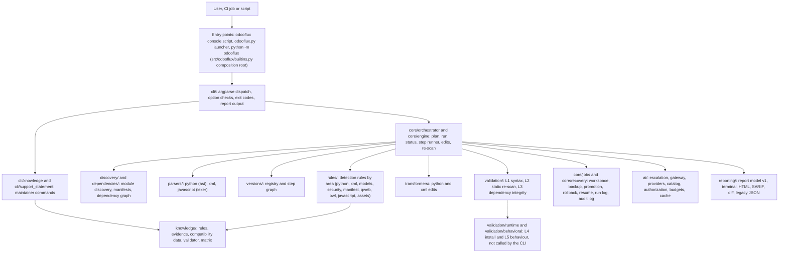

# OdooFlux

OdooFlux analyzes Odoo addon modules and helps move them from one major Odoo version to the next. It reports
the changes a module needs, can apply a limited set of deterministic edits (with backups), checks the result
with static validation layers, and writes reports you can keep as evidence.

> **Status of this project (version 0.2.0)**
>
> - **Production certification is not granted.** The human review register lists it as pending
>   (see [docs/reviews/FINAL_HUMAN_REVIEW_REGISTER.md](docs/reviews/FINAL_HUMAN_REVIEW_REGISTER.md)).
> - **The support statement lists 0 supported paths.** Every version path is `experimental` or `unsupported`.
>   The generated list is in [docs/planning/SUPPORT_STATEMENT.md](docs/planning/SUPPORT_STATEMENT.md).
> - **All expected outputs and the golden fixtures are PROVISIONAL** (ADR-019). They test the framework
>   mechanics; they are not approved migration truth.
> - **Runtime validation (install and behaviour checks in Docker) is not reachable from the CLI.** Every
>   analysis run reports layers L4 and L5 as skipped. See [Section 9](#9-verification-and-statuses).
> - **Optional AI assistance is off by default**, and no knowledge-base rule is currently marked as eligible for it.
>
> Command behaviour, options, defaults and exit codes in this document were checked against the 0.2.0
> implementation on Linux with Python 3.12.3.

## Table of contents

1. [Project overview](#1-project-overview)
   - [What OdooFlux does](#what-odooflux-does)
   - [Why it exists](#why-it-exists)
   - [Workflows](#workflows)
   - [How a module is upgraded](#how-a-module-is-upgraded)
   - [Deterministic rules, the Knowledge Base, and AI](#deterministic-rules-the-knowledge-base-and-ai)
   - [What OdooFlux does not guarantee](#what-odooflux-does-not-guarantee)
2. [Architecture overview](#2-architecture-overview)
3. [Prerequisites](#3-prerequisites)
4. [Installation](#4-installation)
   - [Run from a checkout](#run-from-a-checkout)
   - [Install into a virtual environment](#install-into-a-virtual-environment)
   - [Optional extras](#optional-extras)
   - [Build a wheel and install it](#build-a-wheel-and-install-it)
   - [Verify the installation](#verify-the-installation)
5. [Quick start](#5-quick-start)
   - [Set up a sample addon](#set-up-a-sample-addon)
   - [Step 1: analysis](#step-1-analysis)
   - [Step 2: dry run with a diff](#step-2-dry-run-with-a-diff)
   - [Step 3: apply the deterministic fixes and write reports](#step-3-apply-the-deterministic-fixes-and-write-reports)
   - [Step 4: read the reports](#step-4-read-the-reports)
   - [Step 5: roll back](#step-5-roll-back)
6. [Complete CLI reference](#6-complete-cli-reference)
   - [6.1 Global behaviour and exit codes](#61-global-behaviour-and-exit-codes)
   - [6.2 migrate](#62-migrate)
   - [6.3 plan](#63-plan)
   - [6.4 rollback](#64-rollback)
   - [6.5 resume](#65-resume)
   - [6.6 versions](#66-versions)
   - [6.7 knowledge](#67-knowledge)
   - [6.8 support-statement](#68-support-statement)
   - [6.9 Input and output formats](#69-input-and-output-formats)
   - [6.10 Option count](#610-option-count)
7. [Migration workflows](#7-migration-workflows)
   - [7.1 Analysis only](#71-analysis-only)
   - [7.2 Dry run with a diff](#72-dry-run-with-a-diff)
   - [7.3 Deterministic fixes](#73-deterministic-fixes)
   - [7.4 Multi-version migrations](#74-multi-version-migrations)
   - [7.5 AI-assisted fixes](#75-ai-assisted-fixes)
   - [7.6 Validation and reports in CI](#76-validation-and-reports-in-ci)
   - [7.7 Rollback, recovery and resume](#77-rollback-recovery-and-resume)
   - [7.8 Parallel analysis and incremental runs](#78-parallel-analysis-and-incremental-runs)
8. [AI configuration](#8-ai-configuration)
9. [Verification and statuses](#9-verification-and-statuses)
10. [Troubleshooting](#10-troubleshooting)
11. [Project documentation](#11-project-documentation)

---

## 1. Project overview

### What OdooFlux does

For each addon module you give it, OdooFlux:

1. **Discovers** the module: it reads `__manifest__.py` (or `__openerp__.py`) with `ast.literal_eval`. Customer code is
   parsed, never imported or executed.
2. **Plans** the migration path from the source to the target version, using the version registry and step graph.
   A plan is `READY` or `BLOCKED`.
3. **Analyzes** Python, XML, JavaScript, manifest, security (CSV) and asset files against the rules for each step.
   Each finding has a severity (`CRITICAL`, `WARNING`, `INFO`) and a status.
4. **Optionally fixes** findings that have a deterministic edit. Fix mode takes a backup first, stages the edits in a
   workspace, checks each rewritten file for syntax (L1) and re-scans it to confirm which findings are resolved (L2),
   and only then promotes the files.
5. **Checks dependency integrity** (L3) for each module: references to other modules, XML IDs, groups, models and
   fields. L3 is evaluated on the module as analyzed, before the edits (see [Section 9](#l3-unavailable)).
6. **Reports** the outcome as terminal text, a JSON report, a SARIF 2.1.0 file, a self-contained HTML report,
   and a unified diff of the kept edits.

### Why it exists

Odoo major versions remove and rename APIs (for example `<tree>` views became `<list>`, and `group_operator`
became `aggregator` in 18.0). Moving a custom module by hand means finding each affected line and checking the
dependencies between modules. OdooFlux makes that work repeatable and auditable:

- every run records what it planned, what it changed, and how to undo it;
- every finding names the rule that raised it;
- the output says clearly which checks ran, which did not, and why.

### Workflows

| Workflow | Command | Writes to modules? |
|---|---|---|
| Analyze a module or addons folder | `odooflux migrate ...` | No |
| Show the planned edits as a diff | `odooflux migrate ... --fix --dry-run --diff FILE` | No |
| Apply deterministic fixes, with backup | `odooflux migrate ... --fix` | Yes (reversible) |
| Show the steps and module order | `odooflux plan --from V --to V ...` | No |
| Undo a fix run | `odooflux rollback RUN_ID` | Yes (restores bytes) |
| Continue an interrupted fix run | `odooflux resume RUN_ID` | Yes |
| List registry versions and research status | `odooflux versions` | No |
| Check the knowledge base (maintainers) | `odooflux knowledge ...` | Only with `refresh --apply` or `matrix` without `--check` |
| Regenerate the support statement (maintainers) | `odooflux support-statement` | Writes the statement file |

### How a module is upgraded

- **Analysis** runs the rules for each step of the path (for example `17.0 -> 18.0`, then `18.0 -> 19.0` for a
  17-to-19 run). Modules are processed in dependency order.
- **Fix mode** stages the edits in a per-run workspace. It takes a backup of the original files before the first
  write to each module. Each rewritten file must pass the L1 syntax check; the L2 re-scan then decides which findings
  the edit resolved. If the L1 check fails, the edit is rejected and the finding stays open. The deterministic edits
  are not re-checked by L3 before promotion (the AI path is; see [Section 8](#8-ai-configuration)).
- **Findings** that have no deterministic edit are reported with a suggestion. OdooFlux never edits them
  automatically.

### Deterministic rules, the Knowledge Base, and AI

| Layer | What it is | Edits files? |
|---|---|---|
| Deterministic rules | Code under `src/odooflux/rules/` and rules in the knowledge data (`src/odooflux/knowledge/`). Each knowledge rule has a maturity: `DETECT_ONLY`, `FIX_ENABLED` or `DRAFT`. The 0.2.0 knowledge data has 91 rules: 78 `DETECT_ONLY`, 10 `FIX_ENABLED`, 3 `DRAFT` (not runnable). | Only findings tagged `[AUTO-FIX]`, and only in `--fix` mode |
| Knowledge Base | Evidence records (200 in 0.2.0) that tie each rule to an official source location, plus compatibility data per step. `odooflux knowledge validate` checks it. | No |
| Optional AI assistance | Off unless you enable it. It can only propose edits for findings that a rule marks `ai_eligible` and that have no deterministic fix. In 0.2.0 no rule is marked eligible. | Only in write mode, and only after validation |

### What OdooFlux does not guarantee

- **It does not make a module work on the target version.** Most rules are detect-only. You must review and test
  the module on the target version.
- **It does not install or run Odoo.** Layers L4 (install) and L5 (behaviour) are not run by the CLI.
- **It does not know every change.** Coverage is limited to the rules in the knowledge data for each step.
  A clean report means "no rule matched", not "the module is compatible".
- **It does not certify a migration path.** No path is supported in 0.2.0 (see [Section 9](#9-verification-and-statuses)).
- **It does not check Enterprise modules.** Dependencies on modules that are not in the scanned set are reported as
  `integrity.missing_module` warnings.
- **Its PROVISIONAL results are not approved migration truth.** They test the tool.

---

## 2. Architecture overview

OdooFlux is a Python package in `src/odooflux`. The console script and the `odooflux.py` launcher both enter
through `builtins.main`, the composition root. It loads the knowledge data and registers the parsers, validators,
AI providers and renderers. The core packages never import the optional adapters directly.



| Package | Responsibility |
|---|---|
| `builtins.py` | Composition root: loads knowledge, registers parsers, validators, AI providers and renderers, supplies the L3 check. |
| `cli/` | Argument parsing, dispatch, option validation, exit-code policy, output files. `knowledge` and `support-statement` are dispatched before argparse. |
| `core/` | Contracts; the orchestrator (plan, run, status, AI pass); the engine (step runner, edits, re-scan); jobs (state directory, workspace, promotion); recovery (rollback, resume, run log, audit log). |
| `discovery/`, `dependencies/` | Finds modules, reads manifests literally, builds the dependency graph and the list of core modules. |
| `parsers/` | Python (`ast`), XML, and a JavaScript lexer. |
| `rules/` | Detection and fix rules by area. Knowledge-backed rules are loaded from `knowledge/`. |
| `transformers/` | Builds the edits for Python and XML files. |
| `knowledge/` | Knowledge data, evidence records, the loader, the validator, the matrix and refresh tooling. |
| `versions/` | Version registry (12.0 to 19.0 in 0.2.0) and the step graph. |
| `validation/` | L1 syntax (Python, XML, manifest, JavaScript), L2 re-scan, L3 dependency integrity, and the status decision. The runtime and behavioural packages exist but are not reachable from the CLI. |
| `ai/` | Optional AI assistance: escalation, gateway, providers, catalog, authorization, budgets, cache. |
| `reporting/` | Report model v1, terminal output (stdlib and optional `rich`), HTML, SARIF, unified diff, legacy JSON. |
| `analyzers/` | Business-logic risk inventory, attached to module results. |
| `utils/` | Hashing, atomic writes, path checks, redaction. |

---

## 3. Prerequisites

| Requirement | Needed for | Status in 0.2.0 |
|---|---|---|
| Python 3.10 or newer | Everything | `requires-python = ">=3.10"` in `pyproject.toml`. **Verified on Python 3.12.3 only.** |
| No third-party packages | The core CLI | The core has no runtime dependencies (`dependencies = []`). |
| Optional extras | See the table below | Extras change what the CLI can do only where noted. |
| Docker | Runtime validation (L4 and L5) only | Not needed. The runtime code is not reachable from any CLI command. |
| Git | Getting the source | Needed only to clone or update the repository. |
| An Odoo installation | Nothing | Not needed. OdooFlux does not install or run Odoo. |
| Network access | AI providers (optional) and `pip` when building | Not needed for analysis or for a wheel built with `pip wheel`, which fetches the build backend. |

**Operating systems.** Verified on Linux (kernel `7.0.0-42-generic`). macOS and Windows were **not verified**.

### Optional extras

| Extra | Installs | Effect verified in 0.2.0 |
|---|---|---|
| `js` | `tree-sitter>=0.23,<0.27`, `tree-sitter-javascript>=0.23,<0.26` | Makes the tree-sitter adapter importable. The CLI does not register its JavaScript syntax validator, so CLI output was identical with and without the extra. |
| `xml` | `lxml>=5.0,<7` | No effect on CLI output. The RNG check that uses lxml is not called by the CLI. |
| `rng` | `lxml>=5.0,<7` | Same package as `xml`. No effect on CLI output. |
| `rich` | Nothing (the extra is empty) | `--ui rich` uses the `rich` package when it can be imported. Install it yourself with `pip install rich`. Without it, `--ui rich` prints a notice and uses the built-in renderer. |
| `runtime` | Nothing (empty) | Reserved for runtime validation. |
| `ai` | Nothing (empty) | Reserved for AI providers. AI uses the standard library transport. |

---

## 4. Installation

### Run from a checkout

No installation is needed to run the tool from the repository root:

```bash
cd /path/to/OdooFlux
python3 odooflux.py --help          # launcher: puts src/ first on sys.path
PYTHONPATH=src python3 -m odooflux --help
```

Both commands print the same help. The launcher does not shadow the package when it is run as a script.

### Install into a virtual environment

```bash
cd /path/to/OdooFlux
python3 -m venv .venv
. .venv/bin/activate
pip install -e .
```

`pip install -e .` installs the `odooflux` console script (`odooflux = odooflux.builtins:main`). It writes
`src/odooflux.egg-info`, which the checkout already contains.

### Optional extras

```bash
pip install -e ".[js,xml]"
```

The extras are described in [Section 3](#optional-extras). `pip install -e ".[js,xml]"` was tested in a copy of
the repository.

### Build a wheel and install it

The repository does not document the `build` package, so the wheel is built with `pip`:

```bash
cd /path/to/OdooFlux
pip wheel . --no-deps -w dist/
```

This produces `dist/odooflux-0.2.0-py3-none-any.whl` (about 1.4 MB). The first build may download `setuptools`
for the isolated build environment. The wheel contains the packaged provider catalog
(`odooflux/ai/catalog/providers.json`), the report model schema, and the 247 knowledge JSON files that the loaders
read.

Install the wheel into a fresh environment:

```bash
python3 -m venv ~/odooflux-env
~/odooflux-env/bin/pip install dist/odooflux-0.2.0-py3-none-any.whl
```

The wheel was tested in a fresh venv with no network access (`pip install --no-index --no-deps`).

### Verify the installation

```bash
odooflux --help
odooflux versions
odooflux knowledge validate
```

`odooflux --help` lists `migrate`, `plan`, `rollback`, `resume` and `versions` and exits 0. The `knowledge` and
`support-statement` commands have their own help (`odooflux knowledge --help`, `odooflux support-statement --help`). `odooflux versions` lists the registry versions
(12.0 to 19.0) and the seven research steps, and exits 0. `odooflux knowledge validate` reports
`records=200 rules=91 errors=0 warnings=0` and exits 0.

There is no `odooflux --version` flag. The version is `0.2.0` (`odooflux.__version__`, `pip show odooflux`).

---

## 5. Quick start

This example migrates the golden sample module `tests/golden_fixtures/17.0/kbi_demo` from 17.0 to 18.0. The
module is copied to a temporary folder without its `expected/` directory, so the repository is not changed.

The output below comes from a real run in this environment. Paths, run IDs and timestamps are shortened or
replaced with placeholders. The expected results are **PROVISIONAL**: the fixture and the outputs test the tool,
they are not approved migration truth. The `--provisional-corpus` flag labels each run that way. The same label is
applied automatically to modules under a directory with a `PROVISIONAL.md` marker, and this fixture sits under one.

Run the commands from the repository root, using the installed `odooflux` command (or `python3 odooflux.py`
in place of `odooflux`).

### Set up a sample addon

```bash
WORK=$(mktemp -d)
mkdir -p "$WORK/addons"
cp -r tests/golden_fixtures/17.0/kbi_demo "$WORK/addons/"
rm -rf "$WORK/addons/kbi_demo/expected"
```

The sample module depends on `base` and `mail`, and has views, models, security rules, a cron record and two
static assets.

### Step 1: analysis

Analysis writes nothing into the module. It writes a run record under the state directory.

```bash
odooflux migrate \
  --addons-path "$WORK/addons" \
  --from-version 17 --to-version 18 \
  --state-dir "$WORK/state" \
  --provisional-corpus --no-color
echo "exit code: $?"
```

Real output (shortened):

```text
  Odoo Migration Tool  v17.0 → 18.0
  Modules : 1
  Fix     : NO (analyze only)
  Target  : Odoo 18.0
  AI Fix  : NO
  Run     : 20261107T174056Z-b0356c  (state: <WORK>/state)

  [1/1] kbi_demo
        Path: <WORK>/addons/kbi_demo
        done  [crit=3 warn=11 info=3]

  FILE: __manifest__.py
  [WARNING ] L3     Manifest Version (v18) [AUTO-FIX]
           Module version prefix should be '18.0.x.y.z' for Odoo 18
  ...
  FILE: views/demo_views.xml
  [CRITICAL] L7     Tree Tag Renamed [AUTO-FIX]
           <tree> view tag deprecated in v18 and replaced by <list>
  ...
  SUMMARY
  Critical : 3
  Warnings : 11
  Info     : 3
exit code: 1
```

The exit code is `1` because the module has open `CRITICAL` findings and the default `--fail-on critical` is in
effect. That is the expected result for this sample, not a crash.

### Step 2: dry run with a diff

`--fix --dry-run` computes the edits and writes nothing into the module. `--diff` saves them as a unified diff.

```bash
mkdir -p "$WORK/out"
odooflux migrate \
  --addons-path "$WORK/addons" \
  --from-version 17 --to-version 18 \
  --fix --dry-run \
  --diff "$WORK/out/dryrun.diff" \
  --state-dir "$WORK/state" \
  --provisional-corpus --no-color --ui ansi --filter-severity CRITICAL
echo "exit code: $?"
```

Real output (shortened):

```text
  Fix     : DRY RUN (planned edits only, nothing written)
  ...
  [1/1] kbi_demo
        done  [crit=3 warn=11 info=3 fixed=0]
        Dry run: would change 3 file(s): __manifest__.py, demo.py, demo_views.xml
  ...
  Diff saved → <WORK>/out/dryrun.diff (3 file(s); index <WORK>/out/dryrun.diff.index.json)
PROVISIONAL RUN: 17.0->18.0 rules validated only against the PROVISIONAL corpus;
  not approved migration truth (--provisional-corpus)
Plan  17.0->18.0   status: READY
  ...
 FAILED  kbi_demo
   open C/W/I 3/11/3   fixed 0   rejected 0
   layers: L1 PASS L2 PASS L3 PASS L4 SKIPPED L5 SKIPPED
   Reasons  kbi_demo: open_critical_findings
exit code: 1
```

The diff is a standard unified diff with `a/` and `b/` prefixes, so it applies with `patch -p1` from the folder that
contains `kbi_demo/`. Part of it, for `__manifest__.py`:

```diff
--- a/kbi_demo/__manifest__.py
+++ b/kbi_demo/__manifest__.py
@@ -1,6 +1,6 @@
 {
     'name': 'KBI Demo',
-    'version': '17.0.1.0.0',
+    'version': '18.0.1.0.0',
```

The `.index.json` file next to it lists the files in the diff and any module excluded from it.

### Step 3: apply the deterministic fixes and write reports

```bash
odooflux migrate \
  --addons-path "$WORK/addons" \
  --from-version 17 --to-version 18 \
  --fix \
  --state-dir "$WORK/state" \
  --provisional-corpus --no-color \
  --report "$WORK/out/report.json" --report-format json \
  --sarif "$WORK/out/report.sarif" \
  --html "$WORK/out/report.html" \
  --diff "$WORK/out/fix.diff"
echo "exit code: $?"
```

Real output (shortened):

```text
  Fix     : YES (writes enabled)
  Backup  : verified before each module's first write
  [1/1] kbi_demo
        done  [crit=0 warn=8 info=3 fixed=6]
  ...
  Report saved → <WORK>/out/report.json (json)
  SARIF saved → <WORK>/out/report.sarif
  HTML report saved → <WORK>/out/report.html
  Diff saved → <WORK>/out/fix.diff (3 file(s); index <WORK>/out/fix.diff.index.json)
exit code: 0
```

The three fixed files (`__manifest__.py`, `models/demo.py`, `views/demo_views.xml`) are now changed in
`$WORK/addons/kbi_demo`. The module status is `NEEDS_REVIEW` because open warnings remain. The default exit code
does not fail on `NEEDS_REVIEW`, so the command exits 0. To fail on it, add `--fail-on-status NEEDS_REVIEW`
(which also selects the v1 exit mapping, see [6.1](#61-global-behaviour-and-exit-codes)).

### Step 4: read the reports

Each run writes what you asked for, and nothing else except the state directory.

| Output | Option | Contents |
|---|---|---|
| Terminal (default) | none | Per-module lines and the findings, followed by a summary. Colour is off with `--no-color` or `NO_COLOR`. |
| Terminal summary with status | `--ui ansi` (or `--ui auto`) | Run header, `PROVISIONAL RUN` label when it applies, plan status, module status and its reasons, layer outcomes, findings. |
| JSON, report model v1 | `--report FILE --report-format json` | Full structured report: `run`, `modules` (status, reasons, layers, findings, edits, promoted files), `verification_scope`, `recovery`, `summary`, `ai_usage`, `provisional`. |
| JSON, legacy shape | `--report FILE` (default format `legacy`) | The older per-module JSON shape. Use `json` for new tooling. |
| SARIF 2.1.0 | `--sarif FILE` | One result per finding that is not fixed (11 results for the sample after the fix run, which had 17 findings, 6 of them fixed). Add `--sarif-include-fixed` to include fixed findings as `pass` results. The run's `provisional` label is in the file's run properties. |
| HTML | `--html FILE` | A self-contained, offline HTML page for the run (open it in a browser; it carries the `PROVISIONAL` label when the run is provisional). |
| Unified diff | `--diff FILE` | The kept edits as a patch, plus `FILE.index.json` listing the files and any excluded module. |

A short excerpt of the v1 JSON report from this run:

```json
{
  "run": {"mode": "fix", "status": "COMPLETED", "source": "17.0", "target": "18.0", "plan_status": "READY"},
  "modules": [{
    "name": "kbi_demo",
    "status": "NEEDS_REVIEW",
    "status_reasons": ["open_review_findings"],
    "layers": {"L1": "PASS", "L2": "PASS", "L3": "PASS", "L4": "SKIPPED", "L5": "SKIPPED"}
  }],
  "provisional": {"active": true, "labels": ["17.0->18.0 rules validated only against the PROVISIONAL corpus; ..."]}
}
```

The `verification_scope` section states that L4 and L5 were not run, and gives the limits of the run.

### Step 5: roll back

The run ID is printed on the `Run :` line, and the JSON report records a rollback command.

```bash
RUN_ID=$(python3 -c "import json,sys; print(json.load(open(sys.argv[1]))['run']['run_id'])" "$WORK/out/report.json")
odooflux rollback "$RUN_ID" --state-dir "$WORK/state"
```

Real output (shortened):

```text
restored  <WORK>/addons/kbi_demo/views/demo_views.xml  (pre-run bytes)
restored  <WORK>/addons/kbi_demo/models/demo.py  (pre-run bytes)
restored  <WORK>/addons/kbi_demo/__manifest__.py  (pre-run bytes)
Rollback of <run-id>: 3 restored, 0 conflict(s)
```

Running the same command again prints `already rolled back` and exits 0. If a file was changed after the run, that file
is reported as a `conflict`, left as it is, and the command exits 1.

---

## 6. Complete CLI reference

The entry point is `odooflux`. The same program runs as `python3 odooflux.py` and `python3 -m odooflux` (with
`PYTHONPATH=src` in a checkout).

```text
odooflux [COMMAND] [options]
COMMAND: migrate (default) | plan | rollback | resume | versions | knowledge | support-statement
```

Dispatch rules, verified:

- If the first argument is not a command name, the arguments are passed to `migrate`. So `odooflux --fix --from-version 17 ...` runs `migrate`.
- `odooflux --help` (or `-h`) prints the top-level help and exits 0.
- `odooflux` with no arguments runs `migrate` and fails with a usage error (`--from-version` is required), exit 2.
- `knowledge` and `support-statement` are handled before argparse. Each has its own help: `odooflux knowledge --help`, `odooflux support-statement --help`.
- Any argument `--api-key` (or an unambiguous prefix of it) is checked before parsing. It is rejected only from version 0.3.0 onwards (see [6.2](#62-migrate)).

### 6.1 Global behaviour and exit codes

The default exit mapping is **`legacy`**. It is kept for one minor release (decision D-10). The v1 mapping is the
documented table, and you select it with `--exit-codes v1`, or it is selected automatically when you pass
`--fail-on-status`.

| Code | Meaning | Legacy (default) | v1 (`--exit-codes v1` or `--fail-on-status`) |
|---|---|---|---|
| 0 | Success | No blocked module, no rejected edit, no open finding at or above `--fail-on`. | No BLOCKED module or internal error, no rejected edit, no finding at or above `--fail-on`, and no module whose status is in the `--fail-on-status` list. |
| 1 | Threshold exceeded | An open finding at or above `--fail-on`. | Same condition, plus module status in `--fail-on-status` (default `FAILED`). |
| 2 | Usage or configuration error | Invalid options, option conflicts, AI configuration errors, unsupported version values. Reported before processing. | Same. |
| 3 | Rejected edits in write mode | An AI or fix edit was rejected by validation during `--fix`. | Same. |
| 4 | Blocked module or internal error | A module was blocked (for example backup or promotion failed), the plan is BLOCKED, a directory is invalid, no addon directories were found, the state directory is inside a scanned path, or a resume was refused. | A module status is `BLOCKED` (for example L3 is UNAVAILABLE), or an internal error. |

Precedence is 4, then 3, then 1, then 0. In the legacy mapping, an L3 `UNAVAILABLE` result does not make a module
BLOCKED. See [Section 9](#9-verification-and-statuses) and the troubleshooting entry in [Section 10](#10-troubleshooting).

The `rollback`, `resume`, `plan`, `versions`, `knowledge` and `support-statement` commands have their own codes,
given in their sections.

### 6.2 migrate

Analyzes the modules, optionally fixes them, and writes the outputs. It is the default command.

```bash
odooflux migrate --addons-path DIR --from-version 17 --to-version 18
```

At least one module source is needed (`--module`, `--modules` or `--addons-path`). Without one, the command stops
with `No valid addon directories found` and exits 4.

**Versions.** A version is written as `M` or `M.0` (`17` and `17.0` are the same). Other forms such as `v17` or `17.1`
are rejected with exit 2. The source major version must be lower than the target. The registry covers 12.0 to 19.0,
and a target outside it (for example `20`) is rejected with exit 2.

**Module sources**

| Option | Default | Description |
|---|---|---|
| `--module PATH` | none | One module directory. It is used even without a manifest (see L3 in [Section 9](#9-verification-and-statuses)). |
| `--modules PATH [PATH ...]` | none | Several module directories. |
| `--addons-path DIR` | none | A folder whose child directories are scanned. Children without a manifest are skipped silently. |
| `--skip NAME [NAME ...]` | none | Module directory names to leave out. |

**Versions and mode**

| Option | Default | Description |
|---|---|---|
| `--from-version VERSION` | required | Source version, for example `17` or `17.0`. |
| `--to-version VERSION` | `19` (19.0) | Target version. |
| `--fix` | off | Write mode. Edits are applied, with a backup, unless `--dry-run` is also given. Without `--fix` the run is analysis only. |
| `--dry-run` | off | With `--fix`: plan the edits and write nothing. Without `--fix` it has no effect on the edits (the run is analysis). |
| `--backup` | off | Accepted for compatibility. The backup is taken by default in fix mode. Cannot be combined with `--no-backup` (exit 2). |
| `--no-backup` | off | Skip the pre-write backup. The run is marked not reversible and `rollback` cannot restore it. Cannot be combined with `--diff` in write mode (exit 2). |
| `--allow-unverified` | off | Run even when a step has not been researched. A module that would otherwise pass the static checks is then `NEEDS_REVIEW` (status reason `unverified_plan`). |
| `--enable-rule RULE_ID` | none (repeatable) | Opt in to a `DETECT_ONLY` rule that needs run inputs, for example `*.manifest.version-prefix`. Unknown IDs exit 2. |
| `--plugin MODULE:ATTR` | none (repeatable) | Load an explicit plugin. A plugin that fails to load is reported and skipped; the run continues. Plugins are never loaded automatically. |

**Output**

| Option | Default | Description |
|---|---|---|
| `--report FILE` | none | Write a JSON report. The shape depends on `--report-format`. |
| `--report-format FORMAT` | `legacy` | `legacy` (the older JSON shape), `json` (report model v1), `legacy-json`, `terminal`, `html` or `sarif`. `diff` and `diff-index` are refused here; use `--diff`. Any other registered renderer name is accepted. |
| `--sarif FILE` | none | Write a SARIF 2.1.0 report. |
| `--sarif-include-fixed` | off | Include fixed findings in SARIF as `pass` results. |
| `--html FILE` | none | Write a self-contained offline HTML report. |
| `--diff FILE` | none | Write the kept edits as a unified diff (`patch -p1`), plus `FILE.index.json`. In analysis mode the diff is empty and a note says so. |
| `--ui {auto,ansi,rich}` | none | Print the report-model terminal summary. `auto` and `ansi` use the built-in renderer. `rich` uses the `rich` package when it is importable and otherwise prints a notice and uses the built-in renderer. |
| `--max-findings-per-file N` | `20` | Cap the findings listed per file in `--ui` output. Totals stay exact. Must be at least 1. |
| `--show-fixed` | off | List fixed findings as well as open ones. |
| `--filter-severity {CRITICAL,WARNING,INFO}` | none (all) | Show only findings at or above that severity in the terminal output. |
| `--no-color` | off | Disable colour. `NO_COLOR` in the environment has the same effect. |
| `--provisional-corpus` | off | Label the run `PROVISIONAL`. Also automatic when a module sits under a directory that contains a `PROVISIONAL.md` file. The label is not an approval. |

**Exit policy**

| Option | Default | Description |
|---|---|---|
| `--fail-on {critical,warning,info,none}` | `critical` | Open findings at or above this severity make the run exit 1. `none` disables this check unless `--fail-on-status` is given. |
| `--fail-on-status STATUSES` | none (see note) | Comma list of `FAILED` and `NEEDS_REVIEW`, or `none`. Modules with these statuses make the run exit 1. Passing this option selects the v1 exit mapping. When it is not given, the default is `FAILED` unless `--fail-on none`. |
| `--exit-codes {legacy,v1}` | `legacy` | Exit-code mapping. See [6.1](#61-global-behaviour-and-exit-codes). |

**State and execution**

| Option | Default | Description |
|---|---|---|
| `--state-dir DIR` | `$XDG_CACHE_HOME/odooflux`, or `~/.cache/odooflux` | Where run records, backups and the incremental index are kept. It must not be inside a scanned path (exit 4). |
| `--jobs N` | `1` | Worker processes for analysis and dry run. `0` means one per CPU. A negative value is refused (exit 2). Fix mode always runs serially. The report is the same as for a serial run. |
| `--incremental` | off | Skip modules whose files, rule set and tool version are unchanged since the last incremental analysis. Analysis and dry run only; ignored in write mode. |

**AI options.** These are grouped under "AI assistance (optional; off unless `--ai`)". See [Section 8](#8-ai-configuration).

| Option | Default | Description |
|---|---|---|
| `--ai` | off | Enable provider-neutral AI escalation. Requires consent, a provider, a model, and a job budget. |
| `--ai-provider NAME` | none | Provider name from the catalog (for example `anthropic`, `openai`, `deepseek`, `zai`, `local`). OdooFlux never picks one. |
| `--ai-model ID` | none | A model ID that exists in the merged catalog. The packaged catalog lists no models. |
| `--ai-provider-type {external,local}` | `external` | Recorded in the run configuration. It is **not enforced**: the catalog entry's `type` decides how data is treated. |
| `--ai-consent-send-code` | off | Required with `--ai`. Consent to send minimised source regions to the selected provider. |
| `--ai-authorize PROVIDER=CAT[,CAT]` | none (repeatable) | Grant a provider permission for data categories `source_python`, `source_xml`, `evidence_excerpt`. Forbidden categories are refused. |
| `--ai-disable-external` | off | Kill switch. Blocks all external transmission. The environment variable `ODOOFLUX_AI_DISABLE_EXTERNAL=1` (also `true`, `yes`, `on`) does the same. |
| `--ai-endpoint URL` | catalog value | Override the provider endpoint. External endpoints must use `https://`. |
| `--ai-catalog FILE` | none (repeatable) | A model catalog JSON merged over the packaged one. |
| `--ai-budget-job-tokens N` | none | Job token budget. **Required** when `--ai` is set. Must be positive. |
| `--ai-budget-module-tokens N` | none | Per-module token budget. Must be positive. |
| `--ai-budget-file-tokens N` | none | Per-file token budget. Must be positive. |
| `--ai-budget-request-tokens N` | none | Per-request token budget. Must be positive. |
| `--ai-budget-job-cost AMOUNT` | none | Job cost budget. Needs pricing for the model in the catalog. |
| `--ai-max-retries N` | `2` | Retries for rate-limit and transient errors. Must be 0 or more. |
| `--ai-timeout SECONDS` | `60.0` | Request timeout. Must be greater than 0. |
| `--ai-no-cache` | off | Do not use the AI result cache. |
| `--ai-clear-cache` | off | Clear the AI result cache before the run. |
| `--ai-secrets-file FILE` | none | `KEY=VALUE` credentials file. It must be outside every scanned path, and on POSIX it must not be readable by group or others (use `chmod 600`). |
| `--ai-fix` | off | Legacy whole-file Anthropic path. It implies `--fix` (write mode) unless `--dry-run` is also given. It is exclusive with `--ai`, needs `ANTHROPIC_API_KEY` (or `--api-key`), and is refused while the kill switch is on. The option has no help text in `--help`. |
| `--ai-verbose` | off | With `--ai-fix`: print a 400-character preview of each model response and any notes. The option has no help text in `--help`. |
| `--api-key KEY` | none | **Deprecated.** A key on the command line can leak through shell history and the process list. It prints a warning. It is removed in 0.3.0 (the current version is 0.2.0). Use `ANTHROPIC_API_KEY`. |

Examples:

```bash
# Analyze one module and fail only on CRITICAL findings (default)
odooflux migrate --module ./addons/sale_extra --from-version 17 --to-version 18

# Plan the edits for a whole folder, write nothing, and save the diff
odooflux migrate --addons-path ./addons --from-version 17 --to-version 18 \
  --fix --dry-run --diff out/plan.diff

# Fix with a JSON report and SARIF for code scanning; fail CI on NEEDS_REVIEW too
odooflux migrate --addons-path ./addons --from-version 17 --to-version 18 --fix \
  --report out/report.json --report-format json --sarif out/report.sarif \
  --exit-codes v1 --fail-on-status FAILED,NEEDS_REVIEW
```

Limitations:

- `--fix` changes the files in place (after backing them up). Run it on a copy or under version control first.
- `--dry-run` only has an effect together with `--fix`.
- A module without `__manifest__.py` is analyzed when given with `--module`, but its L3 layer is `UNAVAILABLE`.

### 6.3 plan

Prints the steps and module order for a path. It writes nothing and does not analyze files.

```bash
odooflux plan --from 17 --to 18 --addons-path ./addons
```

| Option | Default | Description |
|---|---|---|
| `--from VERSION` | required | Source version. |
| `--to VERSION` | required | Target version. |
| `--module PATH`, `--modules PATH [PATH ...]`, `--addons-path DIR` | none | Module sources, as in `migrate`. |
| `--allow-unverified` | off | Accept steps that have not been researched. |
| `--plugin MODULE:ATTR` | none (repeatable) | Load an explicit plugin. |

Output: `Plan 17.0 -> 18.0: READY` (or `BLOCKED`), then one line per step with its research status, one line per
module with its dependencies, and any reasons.

Exit codes: 0 for READY, 4 for BLOCKED (for example, a source below 12.0).

Limitations: `plan` does not check that a `--module` path exists (`migrate` does). A source or target that is not
ordered, or not in the registry, is not handled cleanly (see [Section 10](#10-troubleshooting)).

### 6.4 rollback

Restores the files of a fix run to the bytes they had before the run.

```bash
odooflux rollback RUN_ID [--state-dir DIR]
```

| Option | Default | Description |
|---|---|---|
| `RUN_ID` | required | The run to restore (positional). |
| `--state-dir DIR` | `$XDG_CACHE_HOME/odooflux` or `~/.cache/odooflux` | The state directory that holds the run. Must match the one the run used. |

Each file is reported as `restored`, `already` (already at the pre-run bytes), or `conflict` (changed after the run,
left as it is). Exit codes: 0 when everything was restored or was already restored, 1 when at least one file is a
conflict.

Limitations: a run made with `--no-backup` has no backup and cannot be rolled back. In 0.2.0 this case stops with a
traceback and exit 1 instead of a clear message. An unknown run ID also stops with a traceback (exit 1).

### 6.5 resume

Continues a run that was interrupted before it finished. The run is read from the state directory.

```bash
odooflux resume RUN_ID [--state-dir DIR] [--plugin MODULE:ATTR]
```

| Option | Default | Description |
|---|---|---|
| `RUN_ID` | required | The run to continue (positional). |
| `--state-dir DIR` | default state directory | Where the run is stored. |
| `--plugin MODULE:ATTR` | none (repeatable) | Load an explicit plugin. |
| `--api-key KEY` | none | **Hidden** in `--help`. Used only by the legacy `--ai-fix` path. Prefer `ANTHROPIC_API_KEY`. |

Exit codes: 0 when the run completes (including when there is nothing left to do), 4 when the run cannot be resumed,
for example when it was rolled back (`ERROR: RuntimeError: run was rolled back; start a new run`).

The resume path is shared with the normal run, so a resumed run ends with the same report as an uninterrupted one.
This review did not create an interrupted run, so the resume path was not exercised end to end.

### 6.6 versions

Lists the registry versions and the research status of each step.

```bash
odooflux versions
```

| Option | Default | Description |
|---|---|---|
| `--plugin MODULE:ATTR` | none (repeatable) | Load an explicit plugin. |

Output: a table of versions (`VERSION`, `PYTHON MIN`, `SUPPORT`) and a table of steps (`STEP`, `RESEARCH`). In 0.2.0
every version shows `SUPPORT UNSUPPORTED`, and each of the seven steps (`12.0->13.0` to `18.0->19.0`) shows
`RESEARCH_SEEDED`. The `SUPPORT` column is a property of a version in the registry. The support of a *path* is a different
classification, given in the support statement. Exit code 0.

### 6.7 knowledge

Maintainer commands for the Knowledge Base. Run them from a source checkout, because the default paths point into
the repository. Exit codes: 0 success, 1 validation findings, drift or overclaim, 2 usage error, 3 tool error.

#### knowledge validate

```bash
odooflux knowledge validate [--path PATH]
```

| Option | Default | Description |
|---|---|---|
| `--path PATH` | packaged knowledge root (`src/odooflux/knowledge`) | Knowledge tree to validate. |

Prints one line per finding and a summary: `records=200 rules=91 errors=0 warnings=0` in 0.2.0. Exit 1 if there are
errors. A path that does not exist is reported as zero records and exits 0 (see [Section 10](#10-troubleshooting)).

#### knowledge refresh

```bash
odooflux knowledge refresh --repo odoo=/path/to/odoo-clone --revision 17.0=<sha> [--report FILE]
```

Re-checks evidence locations against local clones of the official sources. Prints a JSON report to standard output
(or to `--report FILE`).

| Option | Default | Description |
|---|---|---|
| `--repo NAME=PATH` | none (repeatable) | A local clone of an official source, by name. |
| `--revision BRANCH=SHA` | none (repeatable) | The revision to check for a branch. |
| `--apply` | off | Write moved lines and demote missing records in the knowledge files. Changes the repository. |
| `--report FILE` | none | Write the JSON report to a file. |
| `--search-candidates` | off | For missing matches, search the revision for candidate paths. Slow on partial clones. |
| `--path PATH` | packaged knowledge root | Knowledge tree to refresh. |

#### knowledge matrix

```bash
odooflux knowledge matrix [--check] [--output FILE]
```

Generates the compatibility matrix from the knowledge data.

| Option | Default | Description |
|---|---|---|
| `--check` | off | Compare with the committed file and exit 1 if they differ. |
| `--output FILE` | `docs/planning/VERSION_COMPATIBILITY_MATRIX.md` in the checkout | File to write or check. Without `--check` this overwrites the file. |
| `--path PATH` | packaged knowledge root | Knowledge tree to read. |

Exit codes: 0 when written or up to date, 1 on drift or an overclaim, 2 usage, 3 tool error.

### 6.8 support-statement

Generates the support statement from the knowledge data and the golden fixture index. The output does not depend on
the time, so it is reproducible.

```bash
odooflux support-statement [--out FILE] [--check]
```

| Option | Default | Description |
|---|---|---|
| `--out FILE` | `docs/planning/SUPPORT_STATEMENT.md` | File to write, or to compare with under `--check`. |
| `--check` | off | Do not write. Exit 1 if the file differs from the generated text. |

The command needs a source checkout. Run from an installed wheel it stops with an error and exits 2, because the
fixture index that provides the PROVISIONAL labels is not part of the wheel. Exit codes: 0 written or in sync, 1
drift under `--check`, 2 usage or no checkout, 3 tool error.

In 0.2.0 the statement reports `Paths: 0 supported, 16 experimental, 12 unsupported (of 28).` The 17.0 to 18.0
path is `experimental` and labelled PROVISIONAL.

### 6.9 Input and output formats

**Inputs.** Module directories with `__manifest__.py` or `__openerp__.py`. The manifest is read as a literal
(`ast.literal_eval`) and never executed. Analyzed files include Python (`.py`), XML (`.xml`), JavaScript (`.js`) and
CSV security files. Ignore rules come from a `.gitignore` at the module root.

**Module state and run records.** Each run creates `runs/<run-id>/` under the state directory:

| Path | Created by | Contents |
|---|---|---|
| `state.json` | every run | Plan, options, module results, status. |
| `log/run_log.jsonl` | fix runs | Recovery log used by rollback. |
| `log/audit.jsonl` | every run | Audit trail. Metadata only: no prompts, responses or credentials. |
| `backup/` | fix runs with backup | The original files of each module, plus a manifest. |
| `work/` | fix runs | The per-module workspace used before promotion. |
| `modules/` | fix runs | Per-module results. |

Analysis and dry-run runs create only `state.json` and `log/`. The incremental index is kept in `incremental/`
under the state directory.

**Report formats.** See [Step 4](#step-4-read-the-reports) for the summary. The v1 JSON report (`--report-format json`)
has these top-level keys: `schema_version` (1.0.0), `run`, `modules`, `verification_scope`, `recovery`, `severities`,
`summary`, `ai_usage`, `warnings`, and `provisional` when the run is provisional. Each module has `status`,
`status_reasons`, `status_row`, `layers` (L1 to L5), `findings`, `edits`, `promoted_files` and `rejections`; it also
has a `risk_inventory` section when the run recorded one. Each finding has `rule_id`, `path`, `line`, `severity`, `status` (`OPEN`, `FIXED`, `REJECTED` or
`NEEDS_REVIEW`), `auto_fixable`, `suggestion` and `evidence`.

The `recovery.rollback_cmd` in the JSON report does not include `--state-dir`. Add it yourself if the run used a
non-default state directory.

### 6.10 Option count

**10 commands** (7 top-level: `migrate`, `plan`, `rollback`, `resume`, `versions`, `knowledge`,
`support-statement`; plus the three `knowledge` subcommands `validate`, `refresh`, `matrix`), and **77 options**
(flags and option arguments per command, excluding `-h`/`--help` and the positional run IDs). One of the 77 is
hidden (`resume --api-key`). Some options, such as `--module`, `--addons-path` and `--plugin`, appear on more than
one command.

---

## 7. Migration workflows

### 7.1 Analysis only

Use analysis to see what a module needs before changing anything.

```bash
odooflux migrate --addons-path ./addons --from-version 17 --to-version 18 --state-dir ~/odooflux-runs
```

Nothing in the module changes. The run record is written to the state directory. Use `--report` and `--sarif` to keep
the results. Check the exit code (see [6.1](#61-global-behaviour-and-exit-codes)).

### 7.2 Dry run with a diff

Review the planned edits before they are written:

```bash
odooflux migrate --addons-path ./addons --from-version 17 --to-version 18 \
  --fix --dry-run --diff out/plan.diff --ui ansi
```

The terminal shows `Dry run: would change N file(s)`. The diff is `out/plan.diff`, and `out/plan.diff.index.json`
lists the files and any module the diff excludes (with the reasons). Review the diff in your code review tool.

### 7.3 Deterministic fixes

```bash
odooflux migrate --addons-path ./addons --from-version 17 --to-version 18 --fix --state-dir ~/odooflux-runs
```

What happens, in order:

1. The plan is built. A `BLOCKED` plan stops the run with exit 4.
2. A backup of each module is taken before its first write (unless `--no-backup`).
3. Each edit is checked: the rewritten file must pass the L1 syntax check, and a re-scan (L2) decides which findings
   the edit resolved. An edit that fails L1 is rejected and nothing from that edit is written. L3 is evaluated once
   per module as it stood before the edits, so a deterministic edit is not re-checked by L3 before promotion.
4. The staged files are promoted to the module. Findings that the edit resolved become `FIXED`.
5. The report is written, and the exit code is decided.

Only findings that carry an `[AUTO-FIX]` tag are edited. Everything else is a suggestion for a person. Run
`--show-fixed` to see what changed in the terminal output.

### 7.4 Multi-version migrations

A run from 17 to 19 goes through the steps in order: `17.0->18.0`, then `18.0->19.0`. The plan lists the steps, and
the module order follows the dependencies.

```bash
odooflux plan --from 17 --to 19 --addons-path ./addons
odooflux migrate --addons-path ./addons --from-version 17 --to-version 19
```

Tested in 0.2.0: `plan --from 17 --to 19` is `READY` with two steps, and an analysis for 17 to 19 completes. Every pair
in the registry (12.0 to 19.0, 28 pairs) gives a `READY` plan today, because each step is `RESEARCH_SEEDED`. A step
that has not been researched (`NOT_ASSESSED`) would make the plan `BLOCKED` unless you pass `--allow-unverified`.

Analysis for one hop at a time (for example 17 to 18, then 18 to 19) is the safe approach for a first run, because each
step's findings are easier to review.

### 7.5 AI-assisted fixes

AI assistance is optional and off by default. Read [Section 8](#8-ai-configuration) before enabling it. In brief:

- AI never runs in analysis or dry-run mode.
- It is limited to findings that are marked eligible, have no deterministic fix, and are still open.
- Each proposed edit is validated like a deterministic edit. If the edit introduces a new L3 finding, it is rejected.
- In 0.2.0 no rule is marked eligible, so the escalation path selects no findings.

### 7.6 Validation and reports in CI

A CI job that writes machine-readable results and fails on the things you care about:

```bash
odooflux migrate --addons-path ./addons --from-version 17 --to-version 18 \
  --exit-codes v1 --fail-on critical --fail-on-status FAILED,NEEDS_REVIEW \
  --report out/report.json --report-format json --sarif out/report.sarif --html out/report.html \
  --state-dir "$RUNNER_TEMP/odooflux-state" --no-color
```

Upload `out/report.sarif` for code scanning and keep `out/report.html` as the human-readable artifact. Keep the
state directory outside the addons folder (the tool checks this).

Two cautions for CI:

- The default exit mapping (legacy) does not fail on `NEEDS_REVIEW` and does not turn an L3 `UNAVAILABLE` into exit 4.
  Use `--exit-codes v1` to get the documented table.
- The report says which layers ran. A `PASS` on L1 to L3 is not a runtime result. L4 and L5 are always skipped in 0.2.0.

### 7.7 Rollback, recovery and resume

- **Rollback** restores a fix run's files to their pre-run bytes:
  `odooflux rollback RUN_ID --state-dir DIR`. Files changed after the run are conflicts and are left alone.
  Rolling back twice is safe: the second run reports `already rolled back`.
- **Resume** continues an interrupted fix run: `odooflux resume RUN_ID --state-dir DIR`. A rolled-back run cannot be
  resumed. Start a new run instead.
- **Recovery data** is in `runs/<run-id>/` under the state directory (see [6.9](#69-input-and-output-formats)). Keep
  it until you no longer need to roll back.

### 7.8 Parallel analysis and incremental runs

- `--jobs N` runs analysis and dry run in N worker processes. `--jobs 0` uses one per CPU. The report is the same as
  for a serial run. Verified on the sample module: the module results and summaries of a serial run and a
  `--jobs 2` run are identical. Fix mode always runs serially, and the terminal says so when a parallel request is
  not used.
- `--incremental` records what was analyzed. The next run with the same state directory skips a module whose files,
  rule set and tool version are unchanged. It works for analysis and dry run only; it is ignored in write mode.
  Verified: the second run reported `0 analysed, 1 skipped`.

---

## 8. AI configuration

AI assistance is **off unless you pass `--ai`** (or `--ai-fix`). A plain run never contacts a provider. OdooFlux
does not pick a provider or a model for you.

### Two paths

| Path | Options | What it does | Status in 0.2.0 |
|---|---|---|---|
| Provider-neutral escalation | `--ai` with the provider, model, consent, authorization and budget options | Sends minimised source regions of eligible findings to the selected provider and validates the reply | Configuration is checked; no rule is eligible, so no request is sent by a real run. Live providers are not tested. |
| Legacy whole-file fix | `--ai-fix` | Sends whole files to Anthropic and applies the reply after validation | Requires `ANTHROPIC_API_KEY` (or `--api-key`), refused by the kill switch, not governed by the catalog or `--ai-authorize`. The legacy adapter uses a built-in model constant. Live use is not tested. |

The two paths are exclusive: `--ai` with `--ai-fix` is a usage error (exit 2).

### Required options for `--ai`

All of these must be present, or the run stops with exit 2 before any work:

| Requirement | Option | Error when missing |
|---|---|---|
| Consent | `--ai-consent-send-code` | `--ai needs --ai-consent-send-code` |
| Provider | `--ai-provider NAME` | `--ai needs --ai-provider` |
| Model | `--ai-model ID` (must exist in the catalog) | `--ai needs --ai-model`, or `model_not_in_catalog` |
| Job budget | `--ai-budget-job-tokens N` | `--ai needs --ai-budget-job-tokens` |
| Authorization | `--ai-authorize PROVIDER=CAT[,CAT]` | `authorization_missing` when a call is attempted |

Transmission happens only in write mode: `--fix` without `--dry-run`. Analysis and dry run check the configuration but
send nothing.

### Provider types and environment variables

The packaged catalog (`src/odooflux/ai/catalog/providers.json`) lists providers, endpoints and the **names** of the
credential environment variables. It lists no models, prices or capabilities.

| Provider | Type | Adapter | Credential environment variable | Packaged endpoint |
|---|---|---|---|---|
| `anthropic` | external | anthropic | `ANTHROPIC_API_KEY` | `https://api.anthropic.com/v1/messages` |
| `openai` | external | openai_compatible | `OPENAI_API_KEY` | `https://api.openai.com/v1` |
| `deepseek` | external | openai_compatible | `DEEPSEEK_API_KEY` | `https://api.deepseek.com` |
| `zai` | external | openai_compatible | `ZAI_API_KEY` | `https://api.z.ai/api/paas/v4` |
| `local` | local | openai_compatible | none | none (set `--ai-endpoint` or a catalog value) |
| `fake` | fake | fake | none | test provider; needs `ODOOFLUX_AI_FAKE_SCRIPT` |

The packaged endpoints and the `anthropic_version` header are defaults that the project owner has to verify (see the
catalog's `_comment` and [docs/reviews/automated/C-provider-config-check.md](docs/reviews/automated/C-provider-config-check.md)).

Credentials are read from the environment first. If the variable is not set, `--ai-secrets-file FILE` is read: a
`KEY=VALUE` file that must be outside every scanned path and must not be readable by group or others. The run
configuration that is stored in the run state contains no credential, and the audit log records request metadata only.

### Catalog

Add your models in a separate JSON file and pass it with `--ai-catalog`. Files are merged over the packaged catalog,
and models are merged by `id`:

```json
{
  "schema": "odooflux.ai-catalog/1",
  "providers": {
    "anthropic": {
      "models": [
        {"id": "YOUR-MODEL-ID", "context_window": 200000, "max_output": 8192,
         "structured_output": true, "pricing": null}
      ]
    }
  }
}
```

The numbers are examples. `pricing` may be `null`; `--ai-budget-job-cost` needs a pricing object for the model.
External endpoints must start with `https://`. A `local` provider needs an endpoint.

### Data categories and authorization

Each request names the data it carries. Only these categories can be granted:

| Category | Meaning |
|---|---|
| `source_python` | Python source regions |
| `source_xml` | XML source regions |
| `evidence_excerpt` | Excerpts from the knowledge evidence attached to a rule |

These can **never** be sent or granted: `credentials`, `secrets`, `database_dump`, `customer_data`. Grant what you
need per provider:

```bash
--ai-authorize anthropic=source_python,evidence_excerpt
```

A request is refused unless the provider has a grant for every category it carries. The refusal names the missing
categories. Local providers keep data on the machine and are not subject to these grants.

### Safety filters

- **Sensitive content.** A region that matches a credential, key, connection string with a password, or database dump
  pattern is excluded entirely. It is not redacted and sent. The request is refused with the error kind
  `sensitive_content_excluded`.
- **Minimisation.** Paths must be relative, the system prompt may not contain a filled code block, and the only role
  allowed is the single user message. Otherwise the request is refused.
- **Kill switch.** `--ai-disable-external` or `ODOOFLUX_AI_DISABLE_EXTERNAL=1` blocks every external transmission. With
  `--ai-fix`, the kill switch stops the run before it starts (exit 2).

### Eligibility and escalation

A finding is escalated only when all of these are true:

- its status is `OPEN`;
- its rule is in the rule metadata;
- the rule is marked `ai_eligible`;
- the rule has **no** deterministic fix;
- the rule has at least one evidence record.

Every other finding is skipped and stays open, with a reason such as `not_ai_eligible`, `deterministic_fix_available`
or `no_evidence`. An accepted AI edit goes through the same validation as a deterministic edit (L1, L2 re-scan, L3).
If it adds an L3 finding, all edits for that module are rejected.

### Budgets, retries, cache

- `--ai-budget-job-tokens` is mandatory. Module, file and request budgets are optional. Budget events are listed in the
  report's `ai_usage` section.
- `--ai-max-retries` (default 2) retries rate-limit and transient errors. `--ai-timeout` (default 60 seconds) is the
  request timeout.
- Results are cached under the state directory unless `--ai-no-cache`. `--ai-clear-cache` empties the cache first.

### Offline operation

Without `--ai` and `--ai-fix`, no provider is called, and the report's `ai_usage` section says `enabled: false`. This
was checked by running an analysis inside a network namespace with no network access: it completed with exit 0 and
reported `enabled: false`.

### Limitations

- **Live providers are untested.** The provider adapters are covered by tests with fake transports. No live call was
  made when this document was prepared. Owner verification is open (see the review register).
- **No rule is `ai_eligible`.** In 0.2.0 none of the 91 knowledge rules is marked eligible, so a real run escalates
  nothing. Choosing eligible rules needs evidence and is Knowledge Base work (see
  [docs/planning/KNOWLEDGE_BASE_BACKLOG.md](docs/planning/KNOWLEDGE_BASE_BACKLOG.md)).
- **`--ai-provider-type` is recorded but not enforced.** The catalog entry's type decides.
- **The legacy `--ai-fix` path** does not use the catalog or the data-category grants.
- **Data leaves the machine** for external providers. Authorize only what you have reviewed.

---

## 9. Verification and statuses

OdooFlux separates several things that are easy to confuse. Each report states which ones happened.

| Term | Meaning | Where it appears |
|---|---|---|
| **Finding** | A rule matched a line. It has a severity (`CRITICAL`, `WARNING`, `INFO`) and a status. | `findings`, terminal output |
| **Finding status** | `OPEN` (not handled), `FIXED` (resolved by a validated edit), `REJECTED` (an edit was refused), `NEEDS_REVIEW` (a person must decide). | `findings[].status`, `summary.findings_by_status` |
| **Applied transformation** | An edit that was promoted to the module in fix mode. The backup is kept. | `edits`, `promoted_files`, `summary.edits.applied` |
| **Rejected edit** | An edit that failed validation and was not written. | `rejections`, `summary.edits.rejected` |
| **Validation layer** | L1 (syntax), L2 (static re-scan), L3 (dependency integrity), L4 (install), L5 (behaviour). Each has an outcome: `PASS`, `FAIL`, `UNAVAILABLE` or `SKIPPED`. | `layers`, `verification_scope` |
| **Runtime validation** | L4 and L5 in a Docker-based environment. The code exists in `validation/runtime` and `validation/behavioral`, but **no CLI command invokes it**. Every CLI run reports them as `SKIPPED` with reason `runtime_not_requested`. | `verification_scope.layers_unavailable` |
| **Unsupported or unavailable** | `UNAVAILABLE`: the layer could not run (for example no manifest for L3). `SKIPPED`: not attempted on purpose. Both carry a reason. | `layers[].outcome` |
| **PROVISIONAL** | The run relies on the provisional validation corpus (ADR-019). It is a label, not an approval. | `provisional`, the `PROVISIONAL RUN` line, SARIF `properties`, HTML |
| **Supported (verified) path** | A migration path whose every step has `RULES_TESTED` rules and whose target has a recorded passing runtime run. None exists in 0.2.0. | Support statement |
| **Production certification** | Human approval of the tool for production migrations. **Not granted.** | [docs/reviews/FINAL_HUMAN_REVIEW_REGISTER.md](docs/reviews/FINAL_HUMAN_REVIEW_REGISTER.md) |

### Module status

The module status comes from a decision table. The first matching row wins.

| Row | Status | Triggered when |
|---|---|---|
| 1 | `BLOCKED` | The plan was refused, a tool state failed, or a required layer (L1, L2, L3 always; L4 and L5 if required) is `UNAVAILABLE` or `SKIPPED`. |
| 2 | `FAILED` | A layer is `FAIL`, or there is an open `CRITICAL` finding. |
| 3 | `NEEDS_REVIEW` | Open review findings, open warnings, an unverified plan (`--allow-unverified`), or an unavailable sub-validator. |
| 4 | `VERIFIED_SUCCESS` | L1 to L4 and L5 pass, and L5 coverage is full. Not reachable in 0.2.0. |
| 5 | `INSTALL_VERIFIED` | L1 to L4 pass. Not reachable in 0.2.0. |
| 6 | `STATIC_VALIDATED` | L1 to L3 pass and nothing is open. This is the best status a static run can reach. |

A clean minimal module that needed only an auto-fixable manifest version change went from `NEEDS_REVIEW` before
`--fix` to `STATIC_VALIDATED` after it. L4 and L5 were still `SKIPPED`, so the status says the static checks passed,
not that the module installs or behaves correctly.

### L3 UNAVAILABLE

L3 checks references between modules: dependencies, XML IDs, groups, models and fields, using only the scanned
modules and the core module list for the target. It needs at least one module with a readable manifest in the run.

- If L3 is `UNAVAILABLE` (for example, `--module` was given a folder without a manifest), the module's status is
  **`BLOCKED`** (row 1, `required_layer_unavailable:L3`). That is distinct from `FAIL`, which is row 2.
- Under the **default legacy exit mapping** the same module does not become exit 4. The legacy code looks at the
  module's tool-blocked flag, not its status. In the test with `--fail-on none`, the run exited 0. With the default
  `--fail-on critical` it exited 1 if there were open criticals. With `--exit-codes v1` (or `--fail-on-status`) it exits 4.
- For a fix run, the L3 result is the one computed on the module before the edits. It is not a check of the edited files.
- **Treat a `BLOCKED` module as blocking release readiness**, whatever the exit code says. Use `--exit-codes v1` in CI.

### What a clean report means

A report with `STATIC_VALIDATED` means: the files parse, the static re-scan is consistent, the dependency check passes,
and no rule in the knowledge data matched after the edits. It does **not** mean the module installs, upgrades in a
database, or behaves correctly on the target version. Read `verification_scope.limits` in every report.

---

## 10. Troubleshooting

Only problems that were reproduced in this environment are listed.

**A module in `--addons-path` is missing from the results.**
A child directory with no `__manifest__.py` (or `__openerp__.py`) is skipped without a message. Check that the
manifest exists and that the file is a literal dictionary. If no child has a manifest, the run stops with
`No valid addon directories found` and exits 4.

**`--addons-path` names a folder that does not exist.**
The run stops with a `FileNotFoundError` traceback and exit 1 instead of a clear message. Check the path. (Reproduced.)

**`--module` points at a folder without a manifest.**
The module is analyzed, but L3 is `UNAVAILABLE` (reason `no module with a readable manifest in module_paths`), so the
status is `BLOCKED`. Add the manifest. In the default legacy exit mapping the run may still exit 0 (see
[Section 9](#l3-unavailable)).

**Exit code 1 from an analysis that looks clean.**
The default `--fail-on critical` exits 1 on any open `CRITICAL` finding, even in analysis mode. The sample module has three.
Read the findings, or use `--fail-on warning` or `--fail-on none` if that is what you want.

**Exit code 0 with a `NEEDS_REVIEW` module.**
The default legacy mapping and the default `--fail-on-status` (`FAILED`) do not fail on `NEEDS_REVIEW`. Add
`--fail-on-status NEEDS_REVIEW` (this selects the v1 mapping), or check the JSON report.

**`odooflux support-statement` says it needs a source checkout (exit 2).**
The command reads the fixture index and the knowledge data from the repository. Run it from a checkout, or pass
`--out` to write somewhere else from the checkout. Installed wheels do not include the fixture index.

**`--ai` stops with `--ai needs --ai-consent-send-code` (or another `--ai needs ...` message).**
All required AI options must be given. See [Section 8](#required-options-for---ai). Nothing was sent.

**`model_not_in_catalog: provider/model`.**
The model ID is not in the merged catalog. The packaged catalog lists no models. Add the model with `--ai-catalog`.

**`--ai-fix` stops with the kill switch message (exit 2).**
`--ai-disable-external` or `ODOOFLUX_AI_DISABLE_EXTERNAL=1` is set. `--ai-fix` is refused while it is on. Unset the
variable or remove the flag if you intend to send files. Without a key set, `--ai-fix` stops first with the
missing-key message (exit 2).

**`--ai-fix requires an Anthropic API key` (exit 2).**
Set `ANTHROPIC_API_KEY` in the environment. Do not pass the key on the command line. `--api-key` prints a deprecation warning.

**`rollback` reports a `conflict` and exits 1.**
The file was changed after the run. The tool leaves that file alone. Compare it with the backup in
`runs/<run-id>/backup/` and restore it by hand, or keep your change.

**`rollback` says `already rolled back` (exit 0).**
The files already have their pre-run bytes. Nothing was done. This is normal on a second run.

**`rollback` stops with a `FileNotFoundError` traceback.**
This happens for a run made with `--no-backup` (there is no backup to restore) and for an unknown run ID. Check the
run ID and the `--state-dir`. Runs made with `--no-backup` cannot be rolled back.

**`resume` says `run was rolled back; start a new run` (exit 4).**
A rolled-back run cannot be resumed. Start a new run.

**`--jobs` is refused (exit 2).**
Use `0` (one worker per CPU) or a positive number. Negative values are refused.

**`--state-dir` is inside a scanned path (exit 4).**
Choose a state directory outside every `--addons-path` and `--module` path.

**`--from-version` or `--to-version` is refused (exit 2).**
Versions must be `M` or `M.0` (for example `17` or `17.0`). The source must be lower than the target, and the target
must be in the registry (12.0 to 19.0).

**`--ui rich` prints `(rich is not installed: using the built-in terminal renderer)`.**
Install the `rich` package (`pip install rich`). The `rich` extra itself installs nothing.

**`--api-key` prints the deprecation warning twice.**
This is a known duplicate message. The key value is not printed. Use `ANTHROPIC_API_KEY` instead.

**`odooflux --version` fails with a `migrate` usage error (exit 2).**
There is no `--version` flag. Use `odooflux versions` or `pip show odooflux`.

**`--plugin` prints `WARNING: plugin ... not loaded`.**
The plugin could not be imported or registered. The run continues without it.

---

## 11. Project documentation

| Document | What it covers |
|---|---|
| [docs/TECHNICAL_USAGE.md](docs/TECHNICAL_USAGE.md) | Technical usage guide (in preparation). |
| [docs/changes/P2_CUTOVER.md](docs/changes/P2_CUTOVER.md) | Differences between the P2 command interface and the earlier P0 script. |
| [docs/changes/P0_CHANGE_RECORD.md](docs/changes/P0_CHANGE_RECORD.md) | The earlier P0 change record. |
| [docs/guides/ADDING_A_VERSION.md](docs/guides/ADDING_A_VERSION.md) | How to add a new Odoo version to the registry and knowledge data. |
| [docs/planning/SUPPORT_STATEMENT.md](docs/planning/SUPPORT_STATEMENT.md) | Generated list of supported, experimental and unsupported paths. |
| [docs/planning/VERSION_COMPATIBILITY_MATRIX.md](docs/planning/VERSION_COMPATIBILITY_MATRIX.md) | Generated compatibility matrix per step. |
| [docs/planning/KNOWLEDGE_BASE_BACKLOG.md](docs/planning/KNOWLEDGE_BASE_BACKLOG.md) | Knowledge Base work that is still open. |
| [docs/planning/SECURITY_AND_SAFETY.md](docs/planning/SECURITY_AND_SAFETY.md) | Safety requirements: backups, paths, secrets. |
| [docs/planning/REPORTING_AND_UX.md](docs/planning/REPORTING_AND_UX.md) | Report and terminal design. |
| [docs/planning/AI_ARCHITECTURE_AND_TOKEN_OPTIMIZATION.md](docs/planning/AI_ARCHITECTURE_AND_TOKEN_OPTIMIZATION.md) | AI design, eligibility and budgets. |
| [docs/planning/VALIDATION_AND_TEST_STRATEGY.md](docs/planning/VALIDATION_AND_TEST_STRATEGY.md) | Validation layers and test strategy. |
| [docs/planning/TARGET_ARCHITECTURE.md](docs/planning/TARGET_ARCHITECTURE.md) | Target architecture. |
| [docs/planning/architecture/CONTRACTS.md](docs/planning/architecture/CONTRACTS.md) | Interface contracts (planning level). |
| [docs/planning/ARCHITECTURE_DECISIONS.md](docs/planning/ARCHITECTURE_DECISIONS.md) | Architecture decision records (ADR-013, ADR-017, ADR-019 and others). |
| [docs/planning/RELEASE_CHECKLIST.md](docs/planning/RELEASE_CHECKLIST.md) | What must be true before a release. |
| [docs/planning/RISK_REGISTER.md](docs/planning/RISK_REGISTER.md) | Known risks. |
| [docs/planning/IMPLEMENTATION_STATUS.md](docs/planning/IMPLEMENTATION_STATUS.md) | Implementation status by area. |
| [docs/planning/research/OFFICIAL_EVIDENCE_REGISTER.md](docs/planning/research/OFFICIAL_EVIDENCE_REGISTER.md) | Official sources used as evidence. |
| [docs/planning/reports/AI_BENCHMARK_BASELINE.md](docs/planning/reports/AI_BENCHMARK_BASELINE.md) | AI benchmark baseline. |
| [docs/reviews/FINAL_HUMAN_REVIEW_REGISTER.md](docs/reviews/FINAL_HUMAN_REVIEW_REGISTER.md) | Human review register and pending certification items. |
| [docs/reviews/fragments/ws-c-human-review.md](docs/reviews/fragments/ws-c-human-review.md) | Human review of the AI work stream. |
| [docs/reviews/automated/C-provider-config-check.md](docs/reviews/automated/C-provider-config-check.md) | Provider configuration check (endpoints and headers to verify). |
| [docs/reviews/ODOO_MODULE_UPGRADER_AUDIT.md](docs/reviews/ODOO_MODULE_UPGRADER_AUDIT.md) | Audit of the module upgrader. |
| [tests/golden_fixtures/17.0/PROVISIONAL.md](tests/golden_fixtures/17.0/PROVISIONAL.md) | The PROVISIONAL marker for the 17.0 golden corpus. |
| [tests/golden_fixtures/17.0/kbi_demo/expected/18.0/PROVISIONAL.md](tests/golden_fixtures/17.0/kbi_demo/expected/18.0/PROVISIONAL.md) | Status of the expected 18.0 output for the sample module. |
