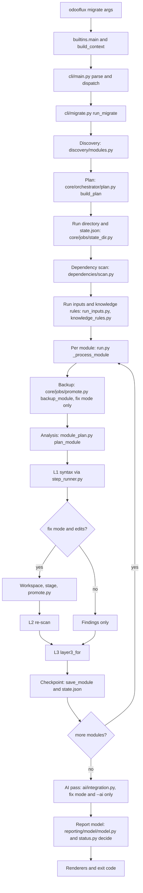
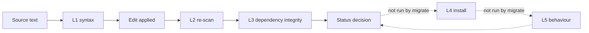

# OdooFlux Technical Usage Guide

This guide describes how OdooFlux is built, how a migration run executes, how the knowledge base is organised, how to extend it, and what the tool can and cannot prove. It is written for developers, maintainers, and reviewers.

For installation basics and the complete CLI reference, see [../README.md](../README.md). This guide does not repeat the full option list; it links to the CLI help output where needed.

**Status of this document.** It describes the code as it exists in the repository on 2026-11-07. The framework is implemented, but **no human review has been recorded and production certification is not granted**. Zero migration paths are currently supported. Read section 13 before making any claim about the tool's accuracy.

## Table of contents

1. [System architecture](#1-system-architecture)
   1.1 [Principles](#11-principles) · 1.2 [Layer boundaries](#12-layer-boundaries) · 1.3 [Dependencies](#13-dependencies) · 1.4 [Extension mechanisms](#14-extension-mechanisms) · 1.5 [Deterministic and AI-assisted paths](#15-deterministic-and-ai-assisted-paths)
2. [Complete directory structure](#2-complete-directory-structure)
   2.1 [Repository root](#21-repository-root) · 2.2 [Package `src/odooflux`](#22-package-srcodooflux) · 2.3 [Other top-level directories](#23-other-top-level-directories)
3. [Execution lifecycle](#3-execution-lifecycle)
4. [Framework layers](#4-framework-layers)
5. [Verification architecture](#5-verification-architecture)
6. [Knowledge base architecture](#6-knowledge-base-architecture)
7. [How to add knowledge base content](#7-how-to-add-knowledge-base-content)
8. [Development guide](#8-development-guide)
9. [Testing strategy](#9-testing-strategy)
10. [Error handling and recovery](#10-error-handling-and-recovery)
11. [Performance architecture](#11-performance-architecture)
12. [Security architecture](#12-security-architecture)
13. [Known limitations and roadmap](#13-known-limitations-and-roadmap)

Labels used throughout: **Implemented** means the code path exists and is reachable from the stated entry point. **Implemented, not wired** means the code exists and has tests but the `migrate` command never calls it. **Planned** means documented only.

---

## 1. System architecture

### 1.1 Principles

| Principle | Where it is realised |
|---|---|
| Stdlib-only core | ADR-002 in [planning/ARCHITECTURE_DECISIONS.md](planning/ARCHITECTURE_DECISIONS.md). The packages listed in section 1.2 import only the standard library; `tests/unit/test_import_graph.py` checks part of this. Optional third-party code sits in adapters declared as extras in `pyproject.toml`. |
| Parse to locate, splice to edit | ADR-003. Parsers return spans; edits replace byte spans and are verified before they are accepted (`src/odooflux/core/engine/edits.py`). |
| Never execute customer code | Manifests are read with `ast.literal_eval` (`src/odooflux/discovery/manifest.py`). Parsers use `ast`, `tokenize`, `expat`, and a lexer; nothing from a scanned module is imported. |
| Data-driven knowledge base | ADR-009. Versions, evidence, rule metadata, and core module lists are JSON files validated by a stdlib schema checker. |
| Evidence is separate from maturity | ADR-008. An evidence status (for example `VERIFIED`) does not by itself make a rule fix automatically. |
| Validate before accept | Every rewritten file passes the L1 syntax validators before its output is accepted (`src/odooflux/core/engine/step_runner.py`). |
| Safe by default | Analysis is read-only. Writes need `--fix`. Writes are backed up and can be rolled back. |
| Explicit plugins only | Plugins load only through `--plugin MODULE:ATTR` (`src/odooflux/cli/plugins.py`; requirement R-03 as cited in the module docstrings). |
| Presentation-independent report | ADR-010. The report model is built from stored run state; renderers (terminal, JSON, SARIF, HTML, diff) are pure functions of the model. |
| Framework first, human review separate | ADR-019. Technical completion and human certification are tracked separately. Provisional fixtures are labelled and never presented as approved truth. |

### 1.2 Layer boundaries

The package is organised in layers. The rules below are the intended boundaries; the core module docstrings state them explicitly (for example `src/odooflux/core/orchestrator/status.py` notes that core packages may not import `odooflux.validation`).

| Layer | Package | Intended imports | Enforced by |
|---|---|---|---|
| Composition root | `src/odooflux/builtins.py` | all layers | by design: the only module that wires adapters into the core |
| Core | `src/odooflux/core/` | standard library, core packages, `utils` | intended (ADR-002, FR-001); `core/orchestrator/status.py` states that core may not import `odooflux.validation`; `core` is not in the import-graph list |
| Stdlib-only packages | `cli`, `discovery`, `versions`, `dependencies`, `reporting/model`, `utils`, `validation/syntax`, `validation/static`, `validation/dependency`, `rules/shared`, `knowledge`, `analyzers` | standard library and each other | `tests/unit/test_import_graph.py` (TST-003-001); one exception: lxml in `validation/static/rng.py`, imported only inside `validate_views` |
| Optional-dependency adapters | `parsers/javascript`, `validation/runtime`, `ai/providers`, `reporting/terminal/rich_adapter.py` | standard library plus optional extras, imported lazily | ADR-002; not in the import-graph list |

Adapters reach the core through registries. The composition root is the only place where they are wired in (`build_context()` in `src/odooflux/builtins.py`).

### 1.3 Dependencies

| Scope | Declared in `pyproject.toml` | Used by | Behaviour when missing |
|---|---|---|---|
| Core | `dependencies = []` | everything in the core | not applicable |
| `js` extra | `tree-sitter`, `tree-sitter-javascript` | `src/odooflux/parsers/javascript/treesitter_adapter.py` | Detection falls back to the stdlib lexer; JavaScript results are detect-only. |
| `xml` extra | `lxml` | optional XML tooling | Stdlib expat is used for spans. |
| `rng` extra | `lxml` | `src/odooflux/validation/static/rng.py` (RELAX NG view validation) | The adapter reports `UNAVAILABLE`; it never claims success. |
| `runtime`, `ai`, `rich` extras | empty placeholders | Docker runtime, AI providers, rich terminal | Docker runtime is unavailable; AI stays off; the ANSI renderer is used. |

Declared extras are placeholders in some cases (`runtime`, `ai`, `rich` are empty lists). The runtime and AI code depends only on the standard library plus the Docker CLI or a configured HTTP endpoint.

### 1.4 Extension mechanisms

Two mechanisms extend the tool.

**Registries** (`src/odooflux/core/contracts/plugins.py`). A `Registries` object holds seven `Registry` instances, one per kind:

```
KINDS = ("versions", "rules", "parsers", "validators", "runtimes", "ai_providers", "renderers")
```

Each entry exposes `key` and `contract_version`. Registration is explicit. The composition root registers the built-in entries in `build_context()`:

| Kind | Built-in entries registered in `src/odooflux/builtins.py` |
|---|---|
| `versions` | one entry per version in the knowledge data |
| `parsers` | `python` (`PythonParser`), `xml` (`XmlParser`) |
| `validators` | `PythonSyntaxValidator`, `XmlSyntaxValidator`, `ManifestSyntaxValidator`, `RescanValidator` |
| `ai_providers` | `legacy-anthropic` (`LegacyAnthropicProvider`), `EscalationPass` |
| `renderers` | `register_default_renderers(registries)` |
| `rules`, `runtimes` | rules are bound from knowledge data at run time (`RunRuleBinder`); no runtime entry is registered by the composition root |

**The composition root** (`src/odooflux/builtins.py`) is the only module that imports adapters into the core. It also owns `main()`, the console-script target declared as `odooflux = "odooflux.builtins:main"`.

**Plugins.** `--plugin MODULE:ATTR` loads a module attribute that exports a `PLUGIN` object (`PluginEntry`: one registry kind and one entry). Plugins never load automatically. `src/odooflux/cli/plugins.py` is the only module allowed to import dynamically.

**Rule modules.** Rule metadata in `src/odooflux/knowledge/compatibility/*.rules.json` names a generic `detector_ref` and `fixer_ref`, for example `odooflux.rules.python.generic:flag_decorator`. Resolution happens in `src/odooflux/rules/shared/loader.py`. Only the modules in `BINDABLE_MODULES` (`src/odooflux/rules/bindable.py`) can be referenced; the loader takes that table as an argument and never imports rule modules itself.

### 1.5 Deterministic and AI-assisted paths

| Path | Mode | Can it change files? | Notes |
|---|---|---|---|
| Parsing, discovery, dependency scan, detection | Deterministic | No | Read-only. |
| Knowledge rules with `FIX_ENABLED` maturity | Deterministic | Yes, with `--fix` | Edits go through the edit engine and validators. |
| Legacy rule tables (`rules/shared/legacy_rules.py`) | Deterministic | Yes, with `--fix` | Retained unchanged from the P0 script. |
| `DETECT_ONLY` rules | Deterministic | Never (SC-005) | Findings only. |
| AI escalation (`--ai`) | Non-deterministic provider output | Only as validated edits, only in fix mode | Off unless enabled and authorized. Section 12. |
| Legacy AI fix (`--ai-fix`) | Non-deterministic provider output | Yes, after validation | Kept for compatibility; see section 13 for its limits. |

---

## 2. Complete directory structure

### 2.1 Repository root

| Path | Purpose |
|---|---|
| `README.md` | User-facing overview and CLI reference. This guide links to it rather than repeating it. |
| `LICENSE` | Project licence. |
| `.gitignore` | Ignore rules. |
| `pyproject.toml` | Package metadata (`odooflux` 0.2.0, Python 3.10 or later), optional extras, console script, and package data. The package data rule ships `knowledge/**/*.json`, `reporting/model/*.json`, and `ai/catalog/*.json` in the wheel. |
| `MANIFEST.in` | Source distribution data inclusion for the same JSON assets. |
| `odooflux.py` | Launcher script. It puts `src/` first on `sys.path` and calls `odooflux.builtins.main`. It is the entry used by tests and by `python odooflux.py`. |
| `src/` | Installable package (section 2.2). |
| `tests/` | Test suite, fixtures, golden data, and benchmarks (section 2.3). |
| `tools/` | Maintainer scripts that are not shipped in the wheel (section 2.3). |
| `knowledge/` | Repository-level golden corpus inputs and review packets (section 2.3). |
| `docs/` | Planning, decisions, reviews, and guides (section 2.3). |
| `specs/` | Spec Kit feature specifications, plans, tasks, and contracts (section 2.3). |
| `.specify/` | Spec Kit templates, scripts, and workflow configuration. |
| `.claude/` | Project settings and Spec Kit skill definitions for Claude Code. `settings.local.json` holds local settings. |

### 2.2 Package `src/odooflux`

Top-level modules: `__init__.py` (package marker, stdlib-only statement), `__main__.py` (`python -m odooflux`), and `builtins.py` (composition root).

| Subpackage | Responsibility | Important modules | Inputs | Outputs | Extension points |
|---|---|---|---|---|---|
| `cli/` | Argument parsing, subcommands, exit-code policy, report output options | `main.py` (parsing and dispatch; keeps every legacy flag), `migrate.py` (migrate command), `commands.py` (plan, rollback, resume, versions), `exit_codes.py`, `ai_options.py`, `knowledge.py`, `support_statement.py`, `report_outputs.py`, `plugins.py`, `deprecations.py` | argv, environment | exit code, terminal output, report files | `--plugin` |
| `core/contracts/` | Registries, protocols, record types | `plugins.py` (`Registry`, `Registries`, `KINDS`), `records.py` (`Step`, `RESEARCH_STATUSES`), `protocols.py` | — | — | Defines what every adapter must provide |
| `core/engine/` | Span edits, conflict handling, re-scan attribution, step runner | `edits.py`, `apply.py`, `documents.py` (byte-exact decoding and encoding), `step_runner.py`, `rescan.py` | document text, findings, edits | accepted or rejected edits, post-fix findings | Validators from the `validators` registry |
| `core/orchestrator/` | Planning, run execution, status decision, rule selection, AI pass, parallel and incremental loops | `plan.py`, `run.py`, `module_plan.py`, `knowledge_rules.py`, `run_inputs.py`, `status.py`, `ai_pass.py`, `parallel.py`, `incremental.py`, `provisional.py` | run state, registries | run state, module results | Rules rows; `RunRuleBinder` |
| `core/jobs/` | Run directories, workspaces, backups, promotion | `state_dir.py`, `workspace.py`, `promote.py` | module path, edits | run directory, backups, promoted files | — |
| `core/recovery/` | Run log, audit log, rollback, resume | `runlog.py`, `audit_log.py`, `rollback.py`, `resume.py` | run directory | log files, restored files | — |
| `discovery/` | Module discovery, manifests, ignore rules | `modules.py`, `manifest.py`, `ignore.py` | paths | module references, file lists | — |
| `dependencies/` | Dependency graph, reference index, core module lists | `scan.py`, `graph.py`, `references.py`, `core_modules.py` | module references, `knowledge/compatibility/core_modules.json` | dependency findings, topological order | — |
| `parsers/python/` | Python parsing and span locators | `document.py` (stdlib `ast` and `tokenize`), `spans.py` | source text | parsed document, spans | `parsers` registry |
| `parsers/xml/` | XML well-formedness and element and attribute spans | `wellformed.py`, `document.py`, `expat_locator.py`, `attr_lexer.py` | XML text | document, spans | `parsers` registry |
| `parsers/javascript/` | JavaScript lexer and optional tree-sitter adapter | `lexer.py` (stdlib, used by JS and OWL rules), `treesitter_adapter.py` (lazy import) | JS text | token spans | Optional `js` extra |
| `transformers/` | Span-based edit helpers | `python.py`, `xml.py`, `modifiers.py` (attrs and states to modifier expressions) | parsed document | edits | Used by fixers |
| `rules/` | Detector and fixer functions, rule binding | `rules/shared/` (loader, legacy tables, legacy adapter, legacy overlap), `rules/bindable.py`, `rules/python/` (generic, sql_constraints), `rules/xml/` (generic, view_mode, view_refs, view_types), `rules/qweb/`, `rules/owl/`, `rules/javascript/`, `rules/manifest/` (files, hygiene), `rules/models/renamed.py`, `rules/security/` (acl_csv, field_refs, record_rules), `rules/assets/` | rule metadata, documents | findings, edits | Metadata rows reference functions here |
| `validation/syntax/` | L1 validators (`python.py`, `xml.py`, `manifest.py`, `javascript.py`) | — | output text | `ValidationResult` | `javascript.py` is not registered in the composition root |
| `validation/static/` | L2 re-scan (`rescan.py`, registered) and RELAX NG view validation (`rng.py`) | `rescan.py`, `rng.py` | output text | post-fix findings | `rng.py` is not wired (section 5) |
| `validation/dependency/` | L3 dependency integrity | `integrity.py` | module path, target version | findings, `ValidationResult` | Injected as `layer3` |
| `validation/runtime/` | L4 install and L5 behaviour pipeline on Docker | `docker_env.py`, `pipeline.py`, `log_classifier.py` | `RuntimeEnvironment` | runtime outcome | Implemented, not wired (section 5) |
| `validation/behavioral/` | Test outcome comparison | `compare.py` | runtime logs | judgement | Implemented, not wired |
| `validation/status.py` | Re-export of the status decision | — | — | — | — |
| `versions/` | Version registry and migration graph | `versions/registry/loader.py`, `versions/graph/graph.py` | `knowledge/compatibility/versions.json` | `OdooVersion` records, steps | Version entries |
| `knowledge/` | Knowledge loader, validator, checks, matrix, refresh, runtime runs, view index | `loader.py`, `validator.py`, `checks.py`, `matrix.py`, `applicability.py`, `refresh.py`, `runtime_runs.py`, `view_index.py` | JSON under `knowledge/` | findings, matrix, refreshed evidence | Add JSON data (section 7) |
| `ai/` | Provider contract, providers, gateway, authorization, escalation, budgets, cache | see section 4.9 | findings, source regions, catalog | validated edits, usage | Provider catalog and adapters |
| `reporting/` | Report model, renderers, exporters, output path checks | `reporting/model/model.py`, `reporting/model/json_renderer.py`, `reporting/model/legacy_json.py`, `reporting/model/legacy_terminal.py`, `reporting/model/output_paths.py`, `reporting/model/schema_check.py`, `reporting/exporters/` (`json_v1.py`, `legacy_json.py`, `sarif.py`, `diff.py`), `reporting/html/html.py`, `reporting/terminal/` (`ansi.py`, `progress.py`, `rich_adapter.py`), `options.py` | run state | model, JSON, SARIF, HTML, diff, terminal text | `renderers` registry |
| `analyzers/` | Business-logic risk inventory | `risk_inventory.py` | module text | inventory | — |
| `utils/` | Atomic writes, hashing, path containment, redaction, AST caches, parse counter | `atomic.py`, `hashing.py`, `paths.py`, `redaction.py` (log and canary redaction), `redact.py` (log and report text redaction), `astnodes.py`, `parsecount.py` | — | — | — |

The package also contains `knowledge/schemas/` (JSON Schema documents), `knowledge/compatibility/` (rule metadata and version data), `knowledge/evidence/` (evidence records), `knowledge/official_sources/` (allow-list and revision pins), `knowledge/gaps.json`, `ai/catalog/providers.json`, `ai/prompts/templates/v1/`, and `reporting/model/` JSON assets. Section 6 describes them.

### 2.3 Other top-level directories

**`tests/`** (details in section 9).

| Path | Contents |
|---|---|
| `tests/unit/` | Unit tests by area, one subdirectory each: `ai/`, `analyzers/`, `cli/`, `dependencies/`, engine/, `knowledge/`, `parsers/`, release/, `reporting/`, `rules/`, `validation/`, plus top-level modules such as `test_import_graph.py`. |
| `tests/integration/` | End-to-end and cross-module tests: `ai/`, hardening/ (failure injection, audit log), `knowledge/`, packaging/ (wheel install), `reporting/`, `validation/`, plus migration, rollback, resume, and determinism tests at the top level. |
| `tests/regression/` | P0 parity and safety tests. `INDEX.md` maps finding IDs to tests. |
| `tests/contract/` | One sample plugin per registry kind, contract-version rejection, raising rules; `ai/` for provider contract tests; samples/ holds the sample plugins. |
| `tests/runtime/` | Opt-in Docker suite (`ODOOFLUX_RUNTIME_TESTS=1`). |
| `tests/benchmarks/` | Synthetic repository generator, timing tests, `BASELINE.md`, `REFERENCE_MACHINE.md`, `budgets.json`, results/ (benchmark output), and `ai/` benchmark. |
| `tests/golden_fixtures/` | Fixture modules and expected outputs. `INDEX.json` lists them. `17.0/kbi_demo` with its expected/18.0 directory is a PROVISIONAL corpus. `p0_kbi_demo_v14` is the P0 reproduction fixture. Other directories feed specific suites. |
| `tests/fixtures/ai/corpus/` | Minimal fixtures for the AI benchmark. |
| `tests/_support/` | Shared helpers: `digest.py`, `normalize.py`, `optin.py` (opt-in decorators), `fixtures.py`, `cli.py`, `p0.py`. |
| `tests/rule_coverage.txt` | Generated report of rule coverage tags (report only). |

**`tools/`** (maintainer scripts; not shipped in the wheel).

| Script | Purpose | Network |
|---|---|---|
| `tools/verify_evidence.py` | Fetches each evidence location at its pinned SHA and checks the excerpt. Usage: `python3 tools/verify_evidence.py EV-390 EV-391`. Cache directory from `EV_CACHE`, default `/tmp/ev_cache`. | Yes (`raw.githubusercontent.com`) |
| `tools/fetch_golden_corpus.py` | Downloads the pinned golden-corpus input modules and verifies sha256 values. `--check` verifies offline. | Yes, unless `--check` |
| `tools/update_expectations.py` | Regenerates PROVISIONAL expected outputs listed in `tests/golden_fixtures/INDEX.json`. | No |
| `tools/extract_core_modules.py` | Lists core modules of an official Odoo clone at a pinned SHA using `git ls-tree`. | No |
| `tools/extract_view_index.py` | Builds the version-pinned view index from an official source tree. | No |

**`knowledge/`** (repository-level data, not the packaged knowledge base).

| Path | Contents |
|---|---|
| `knowledge/golden_corpus/manifest.json` | Pinned official addon inputs (versions 14.0 to 17.0) with sha256 per file. Inputs only. |
| `knowledge/golden_corpus/README.md` | Explains that expected outputs are not generated and require human review. |
| `knowledge/golden_corpus/review/cases/` | 42 review case files awaiting independent review. `knowledge/golden_corpus/review/INDEX.md` and `knowledge/golden_corpus/review/README.md` describe them. |

**`docs/`**

| Path | Contents |
|---|---|
| `docs/guides/ADDING_A_VERSION.md` | Short procedure for adding a version (data only). |
| `docs/planning/` | Architecture decisions (`ARCHITECTURE_DECISIONS.md`), status (`IMPLEMENTATION_STATUS.md`, `FRAMEWORK_COMPLETION_REPORT.md`), backlog (`KNOWLEDGE_BASE_BACKLOG.md`), generated outputs (`VERSION_COMPATIBILITY_MATRIX.md`, `SUPPORT_STATEMENT.md`), and requirements and risk documents. `planning/architecture/`, `planning/phase-handoffs/`, `planning/reports/`, and `planning/research/` hold supporting material. |
| `docs/reviews/` | `FINAL_HUMAN_REVIEW_REGISTER.md` (pending human items), `docs/reviews/fragments/` (register inputs), `docs/reviews/automated/` (automated review reports R1 to R4, performance review D, provider configuration check C). |
| `docs/changes/` | `P0_CHANGE_RECORD.md`, `P2_CUTOVER.md` (intentional differences from the P0 script). |

**`specs/`** (Spec Kit features, one per phase; ADR-015).

| Directory | Feature | Contracts present |
|---|---|---|
| `001-safety-stabilization` | Safety stabilisation | — |
| `002-test-foundation` | Test foundation | — |
| `003-core-architecture` | Core architecture | `cli.md`, `recovery.md`, `registries-and-plugins.md`, `result-model-v1.md` |
| `004-official-source-intelligence` | Official source intelligence | `knowledge-cli.md` |
| `005-structured-transformations` | Structured transformations | `edit-engine.md`, `modifier-converter.md`, `span-locators.md` |
| `006-version-compatibility-rules` | Version compatibility rules | `rule-catalogue.md`; `specs/006-version-compatibility-rules/research-notes/` |
| `007-ai-assistance` | AI assistance | `ai-provider.md`, `budget-and-cache.md` |
| `008-runtime-behavioral-validation` | Runtime and behavioural validation | `runtime-environment.md`, `status-decision.md` |
| `009-reporting-ux` | Reporting and UX | `report-schema-v1.md`, `sarif-and-diff.md` |
| `010-hardening-release` | Hardening and release | `audit-log.md`, `benchmark-protocol.md` |

Each feature directory also has a checklists directory. Specs describe intent. Where a spec and the code differ, this guide documents the code.

**`.specify/`**: Spec Kit templates (`.specify/templates/`), scripts (`.specify/scripts/bash/`), constitution (`.specify/memory/constitution.md`), and workflow configuration (`.specify/workflows/`, `.specify/integrations/`).

**`.claude/`**: `settings.local.json` and `.claude/skills/` with nine Spec Kit skills (`speckit-analyze`, `speckit-checklist`, `speckit-clarify`, `speckit-constitution`, `speckit-converge`, `speckit-implement`, `speckit-plan`, `speckit-specify`, `speckit-tasks`). These support the spec-driven workflow and are not part of the runtime.

---

## 3. Execution lifecycle

This section follows one `migrate` invocation from the command line to the report. Labels show whether each step is **Implemented** (reachable from `odooflux migrate`) or **Implemented, not wired** (exists, tested, not called by the CLI path).



| # | Step | Module(s) | Status | Notes |
|---|---|---|---|---|
| 1 | CLI invocation | `src/odooflux/builtins.py`, `src/odooflux/cli/main.py` | Implemented | `main()` builds the context (versions, parsers, validators, providers, renderers, rule binder) and calls `run(argv, ctx)`. Subcommand defaults to `migrate`. |
| 2 | Input validation | `src/odooflux/cli/migrate.py` (`validate_outputs`, `resolve_ai`) | Implemented | Refuses report paths inside scanned modules (`reporting/model/output_paths.py`) and state directories inside scanned paths (`core/jobs/state_dir.py`). Exit 2 on usage errors. |
| 3 | Input discovery | `src/odooflux/discovery/modules.py`, `ignore.py` | Implemented | `--module`, `--modules`, or `--addons-path`. Walks files without following symlinks out of the module root. |
| 4 | Version detection and planning | `src/odooflux/core/orchestrator/plan.py`, `src/odooflux/versions/graph/graph.py` | Implemented | Builds the step list from the version graph. `BLOCKED` when a version is out of range or a step is `NOT_ASSESSED` without `--allow-unverified`. The planner does not treat `RESEARCH_SEEDED` as blocked (section 13). |
| 5 | Run creation | `src/odooflux/core/jobs/state_dir.py` | Implemented | Creates `runs/<run_id>/` with a `state.json` file and the `log`, `backup`, `work`, and `modules` subdirectories. Writes `plan_created` to the audit log. |
| 6 | Dependency scan | `src/odooflux/dependencies/scan.py` | Implemented | One scan per run. Produces `*.deps.unknown-dependency` findings and feeds the report. |
| 7 | Knowledge rule selection | `src/odooflux/core/orchestrator/knowledge_rules.py` | Implemented | Selects metadata rows whose `step` is in the plan or is `*`. Excludes `DRAFT` and `RETIRED` rows and rules that need a run key unless opted in with `--enable-rule`. |
| 8 | Run inputs | `src/odooflux/core/orchestrator/run_inputs.py` | Implemented | Binds run parameters (the planned target) to opted-in rules through `RunRuleBinder`. A missing required input becomes an `INFO` gap, not a silent skip. |
| 9 | Legacy rules | `src/odooflux/rules/shared/legacy_adapter.py`, `legacy_rules.py` | Implemented | P0 tables run as engine steps named `legacy-<from>-<to>`. `legacy_overlap.py` suppresses a knowledge finding where a legacy row already reported the same construct on the same line. |
| 10 | Structural parsing | `src/odooflux/parsers/` | Implemented | Python and XML parsers are registered. JavaScript uses the stdlib lexer for detection. |
| 11 | Per-module analysis | `src/odooflux/core/orchestrator/run.py` (`_process_module`), `module_plan.py` (`plan_module`) | Implemented | Runs detectors and planned fixers in `depends` order. `DETECT_ONLY` rules never produce edits. |
| 12 | Deterministic transformation | `src/odooflux/core/engine/` (`edits.py`, `apply.py`), `transformers/` | Implemented | Edits are span replacements with `before` checks, overlap resolution, and preservation checks. Only in fix mode. |
| 13 | L1 validation | `src/odooflux/core/engine/step_runner.py`, `validation/syntax/` | Implemented | Python, XML, and manifest validators run before any output is accepted. A failure rejects the file's edits. |
| 14 | Promotion | `src/odooflux/core/jobs/promote.py`, `src/odooflux/utils/atomic.py` | Implemented | Verified backup first; edits are staged in `work/`; each file is written atomically with a hash record in the run log. Failure restores touched files and sets the module `BLOCKED`. |
| 15 | L2 re-scan | `src/odooflux/validation/static/rescan.py`, `core/engine/rescan.py` | Implemented | Re-scans the output. Findings that disappear are attributed to the fix; only `FIX_ENABLED` or legacy rows may be marked fixed. |
| 16 | L3 dependency integrity | `src/odooflux/validation/dependency/integrity.py` via `run.py` (`layer3_for`) | Implemented | Injected as `layer3` by the composition root. Without an adapter the result is `UNAVAILABLE`. |
| 17 | AI eligibility and authorization | `src/odooflux/ai/escalation.py` (`select_eligible`), `ai/authorization.py`, `ai/gateway.py` | Implemented, off unless enabled | Runs only when `--ai` or `--ai-fix` is set, only in fix mode, and only after the deterministic pass. No shipped rule is `ai_eligible`, so no finding is escalated today. |
| 18 | AI validation and promotion | `src/odooflux/ai/integration.py`, `ai/protected.py`, `core/orchestrator/ai_pass.py` | Implemented, not exercised with live providers | Validates syntax, protected identifiers, and shape. Re-runs L3 on the result (layer3 regression check). Rejected edits are not written. |
| 19 | Runtime L4 and behaviour L5 | `src/odooflux/validation/runtime/pipeline.py` | Implemented, not wired | No `migrate` path calls `run_install` or `run_behavior`. Tests call them directly (section 5). |
| 20 | Status decision | `src/odooflux/core/orchestrator/status.py`, called from `src/odooflux/reporting/model/model.py` | Implemented | First matching row wins (section 5.5). |
| 21 | Checkpoints and resume | `run.py` (`run_pipeline`), `core/recovery/resume.py` | Implemented | `state.json` is written after every module in fix mode. `resume` skips finished modules. Section 10. |
| 22 | Reporting | `src/odooflux/reporting/` | Implemented | Terminal text, legacy JSON, JSON v1, SARIF 2.1.0, HTML, and unified diff, all derived from the model. |
| 23 | Exit code | `src/odooflux/cli/migrate.py` (`compute_exit_code`) and `src/odooflux/cli/exit_codes.py` | Implemented | Legacy mapping by default; `--exit-codes v1` or `--fail-on-status` selects the documented table. Section 10. |

Two different module-status vocabularies exist and must not be confused:

| Vocabulary | Where | Values |
|---|---|---|
| Processing state | `state["modules"][i]["status"]` in `run.py` | `PENDING`, `WORKING`, `DONE`, `PROMOTED`, `FAILED`, `BLOCKED` |
| Result decision | `core/orchestrator/status.py` | `BLOCKED`, `FAILED`, `NEEDS_REVIEW`, `VERIFIED_SUCCESS`, `INSTALL_VERIFIED`, `STATIC_VALIDATED` |

### 3.1 Parallel and incremental execution

`--jobs N` and `--incremental` change only how the module loop runs, not what it decides (`src/odooflux/core/orchestrator/parallel.py`, `incremental.py`). Parallel execution applies to analysis and dry-run only; fix mode is always serial. Results are merged in plan order, so the report is identical to a serial run. The incremental index stores a per-module key (file SHA-256 values, rule-set digest, tool digest, run options) under the state directory.

### 3.2 Resume and rollback

`odooflux resume RUN_ID` re-enters `run_pipeline` for an existing run. `odooflux rollback RUN_ID` restores files from the run log. Both are described in section 10.

---

## 4. Framework layers

Each layer lists its source paths, public interface, inputs and outputs, error handling, contracts, dependencies, tests, and extension points. Contract documents are under `specs/*/contracts/`.

### 4.1 CLI and composition root

| Item | Detail |
|---|---|
| Source | `src/odooflux/builtins.py`, `src/odooflux/cli/`, `src/odooflux/__main__.py`, `odooflux.py` |
| Public interface | `builtins.main(argv=None) -> int`; `cli.main.run(argv, ctx)`; subcommands `migrate`, `plan`, `rollback`, `resume`, `versions`, `knowledge {validate,refresh,matrix}`, `support-statement` |
| Inputs | argv, environment (`ODOOFLUX_AI_DISABLE_EXTERNAL`, `ODOOFLUX_AI_FAKE_SCRIPT`, `XDG_CACHE_HOME`, provider credential variables) |
| Outputs | exit code, terminal text, optional report files |
| Error handling | Usage errors exit 2 before processing. `code_for_exception` in `exit_codes.py` maps an internal tool error to exit 4; `SourceChangedError` during a run prints an `ERROR:` line and exits 4 (`cli/migrate.py`). `rollback` on an unknown run ID currently raises an uncaught `FileNotFoundError` (section 13). |
| Contracts | `specs/003-core-architecture/contracts/cli.md`; `specs/004-official-source-intelligence/contracts/knowledge-cli.md` |
| Dependencies | core, knowledge, reporting, ai options |
| Tests | `tests/unit/cli/`, `tests/integration/test_cli_contract.py`, `tests/integration/test_launcher_resolution.py`, `tests/integration/test_cutover_differences.py` |
| Extension points | New subcommand in `cli/main.py`; `--plugin` |

Help text for every command is available with `PYTHONPATH=src python3 -m odooflux COMMAND --help`. The full option reference is in [../README.md](../README.md).

### 4.2 Core contracts and registries

| Item | Detail |
|---|---|
| Source | `src/odooflux/core/contracts/` (`plugins.py`, `protocols.py`, `records.py`, `__init__.py`) |
| Public interface | `Registry(kind)` with `register(entry, plugin=...)`, `get(key)`, `all()`, `__contains__`; `Registries()` with seven kinds; `Step` with `research_status`, `unresearched` (true only for `NOT_ASSESSED`) |
| Inputs | Entries from the composition root and plugins |
| Outputs | Lookup of registered entries |
| Error handling | A plugin that fails its contract version is rejected at registration; tests cover contract-version mismatch and raising plugins |
| Contracts | `specs/003-core-architecture/contracts/registries-and-plugins.md` |
| Tests | `tests/contract/` (`test_plugin_kinds.py`, `test_plugin_contract_mismatch.py`, `test_plugin_exception.py`), `tests/unit/test_contracts.py` |
| Extension points | Each registry kind |

### 4.3 Edit engine

| Item | Detail |
|---|---|
| Source | `src/odooflux/core/engine/` (`documents.py`, `edits.py`, `apply.py`, `step_runner.py`, `rescan.py`) |
| Public interface | `apply_edits(...)`, `run_step(step, path, text, validators)`, `run_steps(...)`, `validate_output(...)`, `resolved_by_rescan(before, after)` |
| Inputs | Document text, span edits with `before` text, validators |
| Outputs | Spliced text, `StepOutcome` (output, findings, rejection reason) |
| Error handling | Stale spans are rejected; overlapping edits are resolved or rejected; byte-exact preservation is verified; a failed L1 validation rejects the file's edits and the module becomes `FAILED` |
| Contracts | `specs/005-structured-transformations/contracts/edit-engine.md`, `span-locators.md`, `modifier-converter.md` |
| Tests | `tests/unit/engine/` (`test_engine_apply.py`, `test_engine_rescan.py`), `tests/unit/test_engine_*`, `tests/integration/test_determinism.py` |
| Extension points | Add a validator to the `validators` registry; add a transformer |

### 4.4 Parsers

| Item | Detail |
|---|---|
| Source | `src/odooflux/parsers/python/`, `parsers/xml/`, `parsers/javascript/` |
| Public interface | `PythonParser`, `XmlParser` (registered); JavaScript `lexer` module; `treesitter_adapter` (optional) |
| Inputs | Source text |
| Outputs | Documents with spans; for JavaScript, token spans for code, strings, templates, comments, and regex literals |
| Error handling | Parsing never executes code. Malformed output is reported by the L1 validators (section 5). |
| Contracts | `specs/005-structured-transformations/contracts/span-locators.md` |
| Dependencies | stdlib; tree-sitter only through the `js` extra and only when enabled |
| Tests | `tests/unit/parsers/` (including `test_js_adapter.py`, `test_js_adapter_disable.py`), `tests/benchmarks/test_parse_perf.py` |
| Extension points | `parsers` registry |

`ODOOFLUX_DISABLE_JS_ADAPTER=1` masks the tree-sitter adapter (`parsers/javascript/treesitter_adapter.py`).

### 4.5 Rules

| Item | Detail |
|---|---|
| Source | `src/odooflux/rules/` (see section 2.2 for modules) |
| Public interface | Generic detectors (`flag_*`, `keyword_in_call`, ...) and fixers (`rename_*`, `remove_*`, ...) addressed by `module:function` references in rule metadata |
| Inputs | Parsed document, context, parameters from metadata (`params`) |
| Outputs | `Finding` records with rule ID, severity, line, message, suggestion; `Edit` records for fixers |
| Error handling | Rule results are findings or edits. In parallel analysis, a worker that raises blocks its own module (`parallel.py`). Exception handling in serial runs is not described in this guide. |
| Contracts | `specs/006-version-compatibility-rules/contracts/rule-catalogue.md`; `knowledge/schemas/rule_metadata.schema.json` |
| Tests | `tests/unit/rules/`, `tests/unit/knowledge/`, `tests/integration/test_knowledge_rules_pipeline.py`, `tests/regression/test_p0_python_fixers.py`, `tests/regression/test_p0_xml_fixers.py` |
| Extension points | Metadata rows (section 7) and new generic functions registered through `rules/bindable.py` |

### 4.6 Validation layers

Section 5 describes each layer and its outcomes in full. In short:

| Layer | Module | Used by `migrate` |
|---|---|---|
| L1 syntax | `validation/syntax/` | Yes (Python, XML, manifest) |
| L2 static re-scan | `validation/static/rescan.py` | Yes |
| L2 RELAX NG views | `validation/static/rng.py` | No (not registered) |
| L3 dependency integrity | `validation/dependency/integrity.py` | Yes |
| L4 install and L5 behaviour | `validation/runtime/`, `validation/behavioral/` | No (tests only) |

### 4.7 Dependencies and version graph

| Item | Detail |
|---|---|
| Source | `src/odooflux/dependencies/`, `src/odooflux/versions/` |
| Public interface | `scan` (run-level dependency scan), `graph` (topological order; cycles reported), `references` (reference index and `*.refs.dangling-reference`), `core_modules` (`*.deps.unknown-dependency`), `VersionGraph`, `load_version_data` |
| Inputs | Module references; `knowledge/compatibility/core_modules.json`; `knowledge/compatibility/versions.json` |
| Outputs | Dependency findings; ordered module list; steps between consecutive versions |
| Error handling | Cycles are reported and external dependencies are ignored in ordering; undecidable references are counted as limits |
| Contracts | `specs/003-core-architecture/` (plan); `knowledge/schemas/core_modules.schema.json`, `version.schema.json` |
| Tests | `tests/unit/test_dependency_graph.py`, `tests/unit/dependencies/` |

### 4.8 Discovery, jobs, and recovery

| Item | Detail |
|---|---|
| Source | `src/odooflux/discovery/`, `src/odooflux/core/jobs/`, `src/odooflux/core/recovery/` |
| Public interface | `find_modules`, `read_manifest` (literal only); `RunDir.create`, `RunDir.open`, `make_workspace`, `backup_module`, `stage_edits`, `promote_module`; `RunLog`, `AuditLog`, `verify_chain`, `rollback`, `resume`, `read_runlog` |
| Inputs | Module paths; run directory; run log |
| Outputs | Run directories; backups; promoted files; log and audit files |
| Error handling | Section 10 |
| Contracts | `specs/003-core-architecture/contracts/recovery.md`; `specs/010-hardening-release/contracts/audit-log.md` |
| Tests | `tests/integration/test_rollback.py`, `test_resume.py`, `test_promote_failure.py`, `test_workspace_isolation.py`, `tests/integration/hardening/` |
| Extension points | None (internal) |

### 4.9 AI layer

| Item | Detail |
|---|---|
| Source | `src/odooflux/ai/` |
| Public interface | `AIRequest`, `AIResponse`, `ModelDescriptor`, `Usage` (`ai/providers/types.py`); `ProviderRegistry` (`registry.py`); `build_gateway` and `Gateway.complete` (`gateway.py`); `Authorizer` (`authorization.py`); `Escalator` and `select_eligible` (`escalation.py`); `EscalationPass` (`integration.py`); `ResultCache` (`ai/caching/cache.py`); `BudgetTree` (`ai/usage/budgets.py`); `UsageLedger` (`ai/usage/usage.py`) |
| Inputs | Findings with rule metadata; minimised source regions; provider catalog; credentials; budget and cache settings |
| Outputs | Validated edits; usage record; cache and budget statistics |
| Error handling | Typed error kinds (`transmission_disabled`, `authorization_category_denied`, `sensitive_content_excluded`, `invalid_request`, `auth`, and others). A denied request is never sent. Rejected replacements are not written. |
| Contracts | `specs/007-ai-assistance/contracts/ai-provider.md`, `budget-and-cache.md`; ADR-017 |
| Tests | `tests/unit/ai/`, `tests/integration/ai/`, `tests/contract/ai/` (live tests are opt-in), `tests/benchmarks/ai/` |
| Extension points | Catalog entries (`ai/catalog/providers.json`); adapters registered through `ai/providers/factory.py` |

Subcomponents:

| Module | Role |
|---|---|
| `ai/providers/factory.py` | Maps catalog `adapter` names to classes. The only place that does so. |
| `ai/providers/anthropic.py` | Messages API adapter over the stdlib transport. No SDK, no logging. |
| `ai/providers/openai_compatible.py` | Chat-completions wire format; used by `openai`, `deepseek`, `zai`, and `local` catalog entries. |
| `ai/providers/fake.py` | Scripted provider replaying request and response pairs. Never opens a transport. |
| `ai/providers/legacy_anthropic.py` | The legacy Claude integration, wrapped unchanged for `--ai-fix`. |
| `ai/providers/transport.py` | Stdlib HTTP transport and bounded retries. |
| `ai/providers/credentials.py` | Loads credentials from the environment or a secrets file outside scanned paths. |
| `ai/prompts/builder.py`, `src/odooflux/ai/prompts/templates/v1/` | Region selection and versioned prompt templates. Template changes create a new version package. |
| `ai/protected.py` | Checks that a replacement keeps protected identifiers and region shape. |

### 4.10 Knowledge layer

Section 6 describes the data. Code: `src/odooflux/knowledge/`. Public interface: `load_knowledge(root)` (`loader.py`), `validate_knowledge(kb)` (`checks.py`), `generate(kb)` and `check_drift(kb, text)` (`matrix.py`), `refresh(kb, repos, revisions)` and `apply_report(...)` (`refresh.py`), `runtime_runs` (`runtime_runs.py`), `view_index` (`view_index.py`), and `check(value, schema)` (`validator.py`, a stdlib JSON Schema subset). Errors are `Finding` records with codes `E001` to `E008` and `W001` to `W002` (section 5.2). Contracts: `specs/004-official-source-intelligence/contracts/knowledge-cli.md`. Tests: `tests/unit/knowledge/`, `tests/integration/knowledge/`, `tests/benchmarks/test_knowledge_validate_perf.py`.

### 4.11 Reporting

| Item | Detail |
|---|---|
| Source | `src/odooflux/reporting/` |
| Public interface | `build_report(state, reports, ...)` in `reporting/model/model.py` (report model v1, a pure function of stored state); renderers `reporting/terminal/ansi.py`, `reporting/model/json_renderer.py`, `reporting/model/legacy_json.py`, `reporting/model/legacy_terminal.py`, `reporting/exporters/json_v1.py`, `reporting/exporters/sarif.py`, `reporting/exporters/diff.py`, `reporting/html/html.py`; `rich_adapter.py` (optional) |
| Inputs | Run state |
| Outputs | Terminal text; JSON v1 (`reporting/model/report.schema.json`); legacy JSON; SARIF 2.1.0; self-contained HTML; unified diff plus `FILE.index.json` |
| Error handling | Report paths inside scanned modules are refused. `rich` is imported lazily; without it the ANSI renderer is used. The HTML renderer uses no JavaScript and no external resources. |
| Contracts | `specs/009-reporting-ux/contracts/report-schema-v1.md`, `sarif-and-diff.md`; `specs/003-core-architecture/contracts/result-model-v1.md` |
| Tests | `tests/unit/reporting/`, `tests/integration/reporting/`, `tests/regression/test_p0_reporting.py` |
| Extension points | `renderers` registry; `register_default_renderers` |

---

## 5. Verification architecture

Verification runs in layers. Each layer returns one outcome per module: `PASS`, `FAIL`, `UNAVAILABLE`, or `SKIPPED` (`core/orchestrator/status.py`). Layers never claim success they did not verify.

### 5.1 Stages



| Stage | Checks | When it runs | PASS | FAIL | UNAVAILABLE | What it cannot prove | Mandatory? |
|---|---|---|---|---|---|---|---|
| Static and structural validators (L1) | Python `ast` parse, XML well-formedness, manifest is a literal dict | Before any output is accepted, in fix mode and for each file | Output parses | Output does not parse; edits for that file are rejected | Not applicable for stdlib validators | Semantics, runtime errors, Odoo behaviour | Yes |
| Re-scan (L2, `rescan.py`) | Re-runs detectors on the output and attributes resolved findings | After promotion in fix mode | No new or unresolved findings where a fix was expected | Findings remain or appear | Not produced for the module | Whether the fix is correct for Odoo | Yes for fix mode |
| RELAX NG view validation (`rng.py`) | Views validate against target RELAX NG schemas | Not run by `migrate` | Valid | Invalid | Missing `lxml` or schema | Behaviour of the view at runtime | No (not wired) |
| Rule applicability and evidence checks | Rule has evidence; evidence IDs exist; maturity matches evidence status; applicability ranges are consistent | `knowledge validate`, rule loading | No errors | `E00x` codes | Not applicable | That the official source is correct today | Yes for release |
| L3 dependency integrity (`integrity.py`) | References to modules, XML IDs, groups, models, fields, Python packages | Every module, every run, via `layer3_for` | No broken reference found | Broken reference found | No module could be read | References the tool cannot decide (counted as limits) | Yes; `UNAVAILABLE` blocks release readiness (ADR-019) |
| Runtime install L4 (`validation/runtime/pipeline.py`) | Module installs on a real Odoo image in Docker | Opt-in test code only | Install completes | Install errors classified in logs | Docker or image missing | Anything beyond install and upgrade | Opt-in |
| Behaviour L5 (`validation/behavioral/compare.py`) | Test outcomes compared between source and target images | Opt-in test code only | Equivalent outcomes | Regression found | Source image missing, or no tests | Equivalence beyond the tests run | Opt-in |
| Regression tests | Fixed findings stay fixed; rollback and resume behave as specified | Automated test suite | All pass | Test fails | Opt-in tests skipped | Correctness on customer code | Yes for release |
| Status decision and release gates | Layer outcomes to a module status (section 5.5) | Every report | Status returned | Status `FAILED` or `BLOCKED` | Recorded as a reason | Human approval | Yes |

### 5.2 Knowledge validation codes

From `specs/004-official-source-intelligence/contracts/knowledge-cli.md`, as implemented in `src/odooflux/knowledge/checks.py`:

| Code | Meaning |
|---|---|
| `E001` | Schema violation |
| `E002` | URL not in the allow-list (`knowledge/official_sources/allow_list.json`) |
| `E003` | Invalid revision (not a 40-character SHA, or a branch name) |
| `E004` | Duplicate ID |
| `E005` | Rule missing evidence |
| `E006` | Unknown evidence ID |
| `E007` | Registry ordering problem |
| `E008` | A transition's `research_status` disagrees with its step research file |
| `W001` | Maturity capped (evidence is `UNVERIFIED` or `CONFLICTING`) |
| `W002` | Identical claim duplicated |

Fixtures demonstrating each code are in `tests/golden_fixtures/knowledge/invalid/`.

### 5.3 Meaning of outcomes

| Outcome | Meaning | Must not be read as |
|---|---|---|
| `PASS` | The check ran and found no problem | Proof of migration accuracy |
| `FAIL` | The check ran and found a problem | — |
| `UNAVAILABLE` | The check could not run (missing adapter, Docker, image, module unreadable) | Success |
| `SKIPPED` | The layer was not requested | Success |

### 5.4 Runtime and installation validation

Runtime validation is designed for disposable containers (ADR-011). The Docker adapter (`validation/runtime/docker_env.py`) creates labelled containers and volumes, enforces limits, and tears them down by label. Images are checked by digest.

Opt-in tests run this path: `ODOOFLUX_RUNTIME_TESTS=1` with a local Docker daemon. The FRAMEWORK_COMPLETION_REPORT records one passing opt-in run (nine tests, Docker 29.7.2, cached images) on synthetic fixtures. No runtime run has been recorded in `knowledge/compatibility/runtime_runs.json` (the file is empty), so no step is `RUNTIME_VALIDATED`.

### 5.5 Status decision

`src/odooflux/core/orchestrator/status.py` evaluates rows in order; the first matching row wins.

| Row | Status | Condition (summary) |
|---|---|---|
| 1 | `BLOCKED` | Plan refused, tool error, or a required layer is `UNAVAILABLE` or `SKIPPED` |
| 2 | `FAILED` | Any layer `FAIL`, or an open CRITICAL finding |
| 3 | `NEEDS_REVIEW` | Open REVIEW or WARNING findings, an unverified plan, or a sub-validator unavailable |
| 4 | `VERIFIED_SUCCESS` | L1 to L4 `PASS`, L5 `PASS`, and full L5 coverage |
| 5 | `INSTALL_VERIFIED` | L1 to L4 `PASS` |
| 6 | `STATIC_VALIDATED` | L1 to L3 `PASS` |
| 7 | `NEEDS_REVIEW` | Fallback; documented as unreachable for valid inputs |

L1 to L3 are always required. L4 and L5 are not produced by the `migrate` CLI, so through the CLI a module can reach at most `STATIC_VALIDATED`, and only when no warning or review finding remains open. This follows from the rows above; it is not a separately tested claim in this guide.

### 5.6 Release gates and certification

Release readiness and production certification are separate (ADR-019). The register in [reviews/FINAL_HUMAN_REVIEW_REGISTER.md](reviews/FINAL_HUMAN_REVIEW_REGISTER.md) lists 52 items, of which 15 are mandatory for production certification. The support statement lists **0 supported paths**, 16 experimental, and 12 unsupported out of 28 (`docs/planning/SUPPORT_STATEMENT.md`). A path becomes supported only when every step is `RULES_TESTED` and the target is `RUNTIME_VALIDATED` (the support statement's rule, `docs/planning/SUPPORT_STATEMENT.md`).

---

## 6. Knowledge base architecture

### 6.1 File layout

```
src/odooflux/knowledge/
  __init__.py, loader.py, validator.py, checks.py, matrix.py, applicability.py,
  refresh.py, runtime_runs.py, view_index.py
  gaps.json
  schemas/                 JSON Schema documents (12 files, see 6.2)
  compatibility/
    versions.json          version list and transitions
    <from>-<to>.research.json   research status per step (12-13 to 18-19, 19-20)
    <from>-<to>.rules.json      rule metadata per step (12-13 to 18-19)
    shared.rules.json      rules with step "*"
    core_modules.json      core module lists per version
    enterprise_modules.json
    legacy_disposition.json
    rng_schemas.json
    rule_candidates.json
    runtime_images.json
    runtime_log_patterns.json
    runtime_runs.json      recorded runtime runs (currently empty)
    view_index/<ver>.json  version-pinned view external IDs (12.0 to 19.0)
  evidence/EV-*.json       evidence records
  official_sources/
    allow_list.json        URL allow-list
    revisions.json         pinned SHAs per branch
```

`src/odooflux/knowledge/evidence/` holds 200 records, `EV-001` to `EV-547`, in numbered series (15 in `0xx`, 25 in `1xx`, 12 in `2xx`, 81 in `3xx`, 41 in `4xx`, 26 in `5xx`). The compatibility files cite 188 distinct evidence IDs. The repository-level `knowledge/` directory (section 2.3) holds only golden corpus inputs and review packets.

The loader reads JSON only and never executes data (`loader.py`, FR-019). Schemas ship inside the package and are used by `checks.py`, `validator.py`, and `reporting/model/schema_check.py`.

### 6.2 Schemas

| Schema file | Title | Governs |
|---|---|---|
| `version.schema.json` | `OdooVersion` | `id`, `python_min`, `python_max`, `online_releases`, `support_status` (`UNSUPPORTED`, `EXPERIMENTAL`, `SUPPORTED`), `evidence` |
| `evidence.schema.json` | `EvidenceRecord` | Evidence records (section 6.4) |
| `rule_metadata.schema.json` | `RuleMetadata` | Rule rows (section 6.3) |
| `step_research.schema.json` | `StepResearchRecord` | Per-step research status and categories |
| `revisions.schema.json` | `RevisionCatalogue` | Pinned SHAs |
| `allow_list.schema.json` | `AllowList` | URL allow-list |
| `core_modules.schema.json` | `CoreModules` | `odooflux.core-modules/1` |
| `rng_schemas.schema.json` | `RngSchemas` | `odooflux.rng-schemas/1` |
| `runtime_log_patterns.schema.json` | `RuntimeLogPatterns` | `odooflux.runtime-log-patterns/1` |
| `runtime_runs.schema.json` | `RuntimeRuns` | `odooflux.runtime-runs/1` |
| `rule_candidates.schema.json` | `RuleCandidate` | Candidate rules not yet in the matrix |
| `gap.schema.json` | `ResearchGap` | `gaps.json` entries |

### 6.3 Rule schema

`rule_metadata.schema.json` describes each element of a `*.rules.json` array. Required fields: `id`, `step`, `category`, `maturity`, `risk`, `evidence`, `detector_ref`, `fixer_ref`, `tests`.

| Field | Type or values | Meaning |
|---|---|---|
| `id` | `^(\d+-\d+\|\*)\.[a-z_]+\.[a-z0-9-]+$` | For example `15-16.python.search-args-keyword` |
| `step` | `N-M` or `*` | Migration step, or `*` for shared rules |
| `category` | string | Rule family |
| `file_kinds` | array of strings | File kinds the rule reads |
| `severity` | `CRITICAL`, `WARNING`, `INFO` | Finding severity |
| `maturity` | `DRAFT`, `DETECT_ONLY`, `FIX_ENABLED`, `RETIRED` | Section 6.5 |
| `review_required` | boolean | Finding needs human review |
| `ai_eligible` | boolean | May be escalated to AI (section 6.7) |
| `risk` | `LOW`, `MEDIUM`, `HIGH` | Risk of the change |
| `evidence` | `EV-NNN` array | Evidence records supporting the rule |
| `not_applicable_reason`, `retired_reason` | string | Explanation for N/A or retirement |
| `depends_on`, `conflicts_with` | arrays of rule IDs | Ordering and conflicts |
| `detector_ref`, `fixer_ref` | `module:function` or null | Generic functions (section 1.4) |
| `params` | object | Parameters passed to the functions |
| `validation` | array of validator names | Validators required after a fix |
| `tests` | array, or object with `positive`, `negative`, `idempotence` | Test IDs such as `TST-006-023` |
| `message`, `suggestion` | string | Text shown in findings |
| `legacy_ref` | string or null | Legacy table row this rule replaces or overlaps |

A real `FIX_ENABLED` example, from `src/odooflux/knowledge/compatibility/12-13.rules.json`:

```json
{
  "id": "12-13.python.api-multi-removed",
  "maturity": "FIX_ENABLED",
  "review_required": false,
  "ai_eligible": false,
  "evidence": ["EV-101"],
  "detector_ref": "odooflux.rules.python.generic:flag_decorator",
  "fixer_ref": "odooflux.rules.python.generic:remove_decorator",
  "params": {"decorator": "api.multi"},
  "validation": ["python-syntax"]
}
```

### 6.4 Evidence records

`evidence.schema.json` requires these fields: `id` (`EV-NNN`), `rule_ids`, `category`, `source_applicability` (`from`, `to`), `target_applicability` (`from`, `to` may be null), `description` (up to 300 characters), `url`, `repository` (`owner/name`), `revision`, `locations`, `detection_method`, `proposed_transformation`, `risk`, `required_validation`, `status`, `checked_on` (date), `checked_by`. Optional: `runtime_test_ref`, `notes`.

`locations` is an array of objects with `branch` (`N.0` or `master`), `revision`, `path`, `line` (integer or null), `match`, `kind` (`present` or `absent`), and optional `search_scope`.

`status` values: `VERIFIED`, `DOCUMENTED_NOT_TESTED`, `UNVERIFIED`, `CONFLICTING`, `NOT_APPLICABLE`. Status is separate from rule maturity (ADR-008).

Real example, `src/odooflux/knowledge/evidence/EV-013.json` (abridged). Here `rule_ids` is empty, although the rule `15-16.python.search-args-keyword` cites `EV-013`; section 13 lists this inconsistency.

```json
{
  "id": "EV-013",
  "category": "orm",
  "source_applicability": {"from": "15.0", "to": "16.0"},
  "target_applicability": {"from": "16.0", "to": null},
  "repository": "odoo/documentation",
  "status": "DOCUMENTED_NOT_TESTED",
  "risk": "MEDIUM",
  "proposed_transformation": "review-only",
  "locations": [{
    "branch": "19.0",
    "kind": "present",
    "line": 150,
    "match": "The argument `args` is renamed to `domain`",
    "path": "content/developer/reference/backend/orm/changelog.rst"
  }]
}
```

### 6.5 Maturity

| Maturity | Selected for a run | Detection | Edits | Use |
|---|---|---|---|---|
| `DRAFT` | No | No | No | Under construction; excluded by `knowledge_rules.py` |
| `DETECT_ONLY` | Yes | Yes | Never (SC-005) | Finding for review |
| `FIX_ENABLED` | Yes | Yes | Yes, with `--fix`, through the edit engine and validators | Deterministic change |
| `RETIRED` | No | No | No | Kept for history; `retired_reason` may be recorded |

In the current data: 78 rules are `DETECT_ONLY`, 10 are `FIX_ENABLED`, and 3 are `DRAFT` (91 in total). `AUTO_TRANSFORM` appears in the backlog text only; it is not in the schema and is not implemented.

Evidence can cap maturity. A rule whose evidence is `UNVERIFIED` or `CONFLICTING` is capped and reported as `W001`.

### 6.6 Precedence and legacy coexistence

Knowledge rules and legacy rule tables run together in the `migrate` pipeline (section 3, steps 7 and 9).

- Legacy rows from the P0 script run unchanged as `legacy-<from>-<to>` steps (`rules/shared/legacy_adapter.py`, `legacy_rules.py`).
- `rules/shared/legacy_overlap.py` lists pairs of knowledge rule IDs and legacy categories that describe the same construct. A knowledge finding is suppressed on a line where a listed legacy category already reported. The module docstring states that every ID is checked against the disposition table by `tests/unit/test_knowledge_rule_selection.py`.
- Retiring a legacy row is a human decision (register item WSE-001). Nothing is retired in code.
- The disposition file is `knowledge/compatibility/legacy_disposition.json`.

### 6.7 `ai_eligible` metadata

`ai_eligible` marks a rule whose findings may be sent to an AI provider for a proposed fix. `escalation.select_eligible` skips a finding that is already fixed, belongs to an unknown rule, or whose rule has `ai_eligible: false`. **All 91 shipped rules have `ai_eligible: false`**, so the AI pass selects nothing in the current data.

### 6.8 Review requirements

| Field | Effect |
|---|---|
| `review_required: true` | Findings are flagged for human review and cannot be treated as settled. 73 of 91 rules set it. |
| Evidence `status` below `VERIFIED` | The rule's claim is not verified by a test in this repository. |
| `PROVISIONAL` label | Fixture expectations and corpus outputs labelled PROVISIONAL are generated by the engine and are not approved. |

### 6.9 Validation commands

```bash
PYTHONPATH=src python3 -m odooflux knowledge validate
PYTHONPATH=src python3 -m odooflux knowledge matrix --check
PYTHONPATH=src python3 -m odooflux support-statement --check
```

Observed results on 2026-11-07 in this repository:

| Command | Result |
|---|---|
| `knowledge validate` | `records=200 rules=91 errors=0 warnings=0`, exit 0 |
| `knowledge matrix --check` | `matrix up to date: .../docs/planning/VERSION_COMPATIBILITY_MATRIX.md`, exit 0 |
| `support-statement --check` | `.../docs/planning/SUPPORT_STATEMENT.md is up to date`, exit 0 |

### 6.10 Packaging

The wheel ships every runtime asset the loaders read: `knowledge/**/*.json`, `reporting/model/*.json`, and `ai/catalog/*.json` (`pyproject.toml` `[tool.setuptools.package-data]`). The FRAMEWORK_COMPLETION_REPORT records 246 JSON assets in the wheel and one clean-venv install (opt-in test `ODOOFLUX_PACKAGING_INSTALL=1`).

---

## 7. How to add knowledge base content

Follow the steps that apply. Never invent evidence, mappings, or results. If an official source does not show a construct, do not create a rule for it. Record it as a gap in `knowledge/gaps.json` or in the backlog.

Read [guides/ADDING_A_VERSION.md](guides/ADDING_A_VERSION.md) for the version procedure. The steps below add the detail the rules need.

### Step A. New version or transition

1. Add the version to `src/odooflux/knowledge/compatibility/versions.json` with fields required by `version.schema.json` (`id` like `20.0`, `python_min`, `python_max`, `online_releases`, `support_status`). The packaged data marks every version `UNSUPPORTED` today; keep new entries `UNSUPPORTED` until the support rule in section 5.6 is met.
2. Add the transition in the same file. Transitions connect consecutive versions only.
3. Create `compatibility/<from>-<to>.research.json` conforming to `step_research.schema.json`. Start with `research_status: NOT_ASSESSED`. Move it to `RESEARCH_SEEDED` or `RESEARCHED` only as research is done.
4. Pin each official branch in `src/odooflux/knowledge/official_sources/revisions.json`. Use full 40-character SHAs only (`E003` rejects branch names).
5. Add any new URL host or path prefix to `src/odooflux/knowledge/official_sources/allow_list.json` (`E002`).
6. Generate core module data with `tools/extract_core_modules.py` and the view index with `tools/extract_view_index.py`, from a local official clone at the pinned SHA. `extract_core_modules.py` reads git data only. Read the docstring of `extract_view_index.py` for its inputs before running it.
7. Run `knowledge validate`, then `knowledge matrix --check` after regenerating the matrix with `knowledge matrix` (without `--check`) and reviewing the diff.

Existing tests for this procedure: `tests/integration/test_adding_version_procedure.py` and `tests/integration/test_add_version_with_rule.py`.

### Step B. Compatibility rule

1. Add an entry to `compatibility/<from>-<to>.rules.json` (or `shared.rules.json` for `step: "*"`). Use the field set in section 6.3.
2. Set `maturity` to `DRAFT` while it is being written. Move to `DETECT_ONLY` for detection, or `FIX_ENABLED` only when Step D is complete.
3. Set `ai_eligible: false` unless there is evidence and an owner decision for AI escalation.
4. Set `review_required: true` unless a human has reviewed the claim.
5. Set `evidence` to existing `EV-NNN` IDs. Unknown IDs fail `E006`. A non-DRAFT rule with no evidence fails `E005`.
6. Reference generic functions by `detector_ref` and `fixer_ref`. Do not add rule code in the JSON.
7. Add `tests` IDs and matching test code (Step F).

### Step C. Evidence record from an authoritative source

1. Choose an official source: `odoo/odoo` or `odoo/documentation` at a pinned SHA present in `revisions.json`.
2. Create `src/odooflux/knowledge/evidence/EV-NNN.json` with the next unused number (the directory holds `EV-001` to `EV-547`; use `ls` to find gaps). Never reuse an ID. Fill every required field (section 6.4). Use `checked_by` for the person or process that checked it, and `checked_on` as the date.
3. Record each `locations` entry with the exact `path`, `line`, and an excerpt in `match`. Use `kind: absent` only when the construct is expected to be missing and a search scope is given.
4. Verify the record with `tools/verify_evidence.py`. Run it with IDs, for example:

   ```bash
   EV_CACHE=$(mktemp -d) python3 tools/verify_evidence.py EV-013
   ```

   It needs network access to `raw.githubusercontent.com`; it was not run for this guide. It prints one JSON line per location (`OK`, `BAD_REVISION`, `EXCERPT_MISMATCH`, or `ABSENT_FAIL`).

   **Warning.** Run with no arguments, the script prints `FAILURES 0` and checks nothing. Treat that output as meaningless. A passing check needs arguments and a successful fetch.

5. Set `status` honestly. Use `VERIFIED` only when the location was checked against the pinned source; `DOCUMENTED_NOT_TESTED` when the claim is documented but no runtime test exists.
6. Run `knowledge validate`.

### Step D. Deterministic transformation (FIX_ENABLED)

1. Write a fixer as a generic function in the relevant `rules/<language>/generic.py` module. Its output must be edit records that the edit engine accepts (`src/odooflux/core/engine/edits.py`), not a rewritten file. Follow the pattern of `remove_decorator` in `rules/python/generic.py` or `rename_keyword` in the same module.
2. Make the fixer idempotent: a second run on its own output produces no edit.
3. Add the function to `rules/bindable.py` if the module is not already bindable.
4. Set `fixer_ref`, `validation` (for example `python-syntax`), and `maturity: FIX_ENABLED` only after positive, negative, and idempotence tests exist.
5. Keep `review_required` true when a human must confirm the change. The 10 current `FIX_ENABLED` rules all set it to `false`; treat that as a decision to re-check, not a template.

### Step E. Detect-only rule

1. Set `fixer_ref: null` and `maturity: DETECT_ONLY`.
2. Set `review_required: true` and write a `suggestion` that tells a human what to check. The engine never edits for `DETECT_ONLY` rules (SC-005).
3. Use `tests` with at least `positive` and `negative` IDs.

Example: `12-13.python.api-one-removed` is `DETECT_ONLY` with `fixer_ref: null` and `review_required: true`.

### Step F. Regression and golden fixtures

1. Add a regression test for the finding ID in the relevant `tests/regression/test_*.py` file, and add a row to `tests/regression/INDEX.md` (`path::Class::method`). `test_regression_index.py` checks it.
2. Add `rule:<category>:positive|negative|idempotence` tags in test docstrings for coverage reporting.
3. For a new fixture module, add an entry to `tests/golden_fixtures/INDEX.json` with `id`, `source_version`, `module`, `path`, `targets`, `evidence`, `findings`, `authority`, `layout`, `input_digest`. `test_fixture_validity.py` and `test_zz_input_immutability.py` check it.
4. Expected outputs are generated only by `tools/update_expectations.py`, which labels them PROVISIONAL. The current provisional corpus is `tests/golden_fixtures/17.0/kbi_demo/expected/18.0`, with `PROVISIONAL.md` markers and `"authority": "PROVISIONAL"`. These prove framework mechanics, not migration accuracy. `tests/integration/test_provisional_corpus.py` fails if the labels are changed.
5. The repository-level golden corpus (`knowledge/golden_corpus/`) provides pinned inputs for 14.0 to 17.0. Its 42 review cases in `knowledge/golden_corpus/review/cases/` are pending independent review. Do not approve them in code or in fixture labels.

### Step G. Validation

Run in this order:

```bash
PYTHONPATH=src python3 -m odooflux knowledge validate
PYTHONPATH=src python3 -m odooflux knowledge matrix --check
PYTHONPATH=src python3 -m odooflux support-statement --check
PYTHONPATH=src python3 -m unittest discover -s tests/unit/knowledge -p 'test_*.py' -t .
```

If `matrix --check` fails, regenerate with `PYTHONPATH=src python3 -m odooflux knowledge matrix` and review the diff. If `support-statement --check` fails, run `PYTHONPATH=src python3 -m odooflux support-statement` after the matrix is current.

### Step H. Unsupported and unverified cases

| Situation | What the tool does | What you should do |
|---|---|---|
| Step has `NOT_ASSESSED` research | Plan is `BLOCKED` unless `--allow-unverified` is given; with that flag, every module is capped at `NEEDS_REVIEW` | Complete research before claiming support |
| Rule has `UNVERIFIED` or `CONFLICTING` evidence | Maturity capped; `W001` reported | Re-verify the evidence or downgrade the rule |
| No evidence for a construct | Do not create a rule | Record a gap in `knowledge/gaps.json` or the backlog |
| Construct needs model-aware analysis | Document as unmapped | Track in `docs/planning/KNOWLEDGE_BASE_BACKLOG.md` |
| Runtime validation not done | Path stays `EXPERIMENTAL` or `UNSUPPORTED` in the support statement | Record a real run in `runtime_runs.json` only after it executed |

---

## 8. Development guide

### 8.1 Environment

The core needs only Python 3.10 or later. The repository's own tests use the standard library.

```bash
cd "/path/to/OdooFlux"
python3 -m venv .venv
. .venv/bin/activate
python -m pip install -e ".[js,xml]"    # optional extras as needed
PYTHONPATH=src python3 -m odooflux --help
```

Install the `ai`, `runtime`, or `rich` extras only if you need them; they are placeholders and add no code. The `js` extra installs tree-sitter for the optional adapter. The `xml` and `rng` extras both install `lxml`.

### 8.2 Conventions

- Stdlib only in core packages. Import optional modules lazily inside the function that needs them (see `validation/static/rng.py`).
- Name each requirement in docstrings (`REQ-*`, `FR-*`, `TST-*`), as the existing modules do.
- Tests write only to temporary directories and pass the state directory explicitly.
- Do not import from the root `odooflux.py`; tests import from `src/`.
- Reports are pure functions of run state (`reporting/model/model.py`). Records marked frozen in `core/contracts/records.py` are immutable.

### 8.3 Adding a parser

1. Implement the parser in `src/odooflux/parsers/<language>/`, returning a document with spans.
2. Wrap it in an entry object exposing `key`, `contract_version`, and `parse` (see `_ParserEntry` in `builtins.py`).
3. Register it in `build_context()` in `src/odooflux/builtins.py`.
4. Add unit tests in `tests/unit/parsers/`.

### 8.4 Adding a transformation operation

1. Add the helper in `src/odooflux/transformers/` returning span edits.
2. Write a generic fixer in `rules/<language>/generic.py` that uses it, and add it to `rules/bindable.py`.
3. Test positive, negative, and idempotence cases, and add a golden case if the change alters output.

### 8.5 Adding a CLI command

1. Add a parser and handler in `src/odooflux/cli/` (commands other than `migrate` go in `cli/commands.py`).
2. Register the subcommand in `cli/main.py`.
3. Document it in `../README.md` (the CLI reference) and add a `tests/integration/test_cli_contract.py` case.
4. Keep D-10 legacy behaviour unchanged for existing flags (section 10.4).

### 8.6 Adding a planner feature

Planner logic lives in `core/orchestrator/plan.py` and `versions/graph/graph.py`. Keep planning pure: no file writes. Add tests in `tests/unit/` and `tests/integration/test_planner_wiring.py`.

### 8.7 Adding a validation layer or validator

1. Implement a `validate(path, text)` method returning `ValidationResult` (see `RescanValidator`).
2. Register it in `build_context()`.
3. Decide whether its `UNAVAILABLE` result blocks the module. Layers L1 to L3 are always required (`status.py`). Adding a required layer changes the status decision; discuss it through a spec amendment first (ADR-019).

### 8.8 Adding an AI provider

Provider configuration is data. The packaged catalog `src/odooflux/ai/catalog/providers.json` has entries for `anthropic`, `openai`, `deepseek`, `zai`, `local`, and `fake`. Each entry sets `type` (`external`, `local`, or `fake`), `adapter`, `endpoint`, `credential_env`, and `models`.

| Catalog field | Notes |
|---|---|
| `models` | Empty in the packaged catalog. Model IDs, context windows, and prices are owner configuration. Merge your own with `--ai-catalog FILE`. |
| `endpoint` | Defaults that the project owner must verify (see the catalog `_comment` and `docs/reviews/automated/C-provider-config-check.md`). |
| `options.anthropic_version` | Header default for the Anthropic adapter; unverified in this repository. |
| `credential_env` | Name of the environment variable that holds the key. Keys are never stored in the catalog. |

To add a provider that speaks an existing wire format, add a catalog entry with the matching `adapter` (`anthropic` or `openai_compatible`). A new wire format needs an adapter module in `src/odooflux/ai/providers/`, a mapping in `factory.py`, and contract tests in `tests/contract/ai/`. Live contract tests are opt-in (`ODOOFLUX_AI_TESTS=1`) and need a key and a model ID from your own catalog.

### 8.9 Writing tests

- Name tests `test_*.py` and place them in the matching `tests/unit/`, `tests/integration/`, or `tests/regression/` folder.
- Cite the requirement or finding ID in the docstring.
- Use `tests/_support/` helpers: `fixtures.copy_fixture`, `digest`, `normalize`, `cli.run_legacy_cli`.
- Use `tests/_support/optin.py` decorators (`requires_runtime`, `requires_ai`) for opt-in tests.
- For a regression test, add the row to `tests/regression/INDEX.md`.

### 8.10 Targeted and full test commands

See section 9.

---

## 9. Testing strategy

### 9.1 Commands

Full suite (as documented; not re-run for this guide):

```bash
PYTHONPATH=src python3 -m unittest discover -s tests -p 'test_*.py' -t .
```

The `-t .` is required. Without it, discovery of the package-style test modules fails. Verified on the knowledge subset:

```bash
# Verified: 75 tests, OK
PYTHONPATH=src python3 -m unittest discover -s tests/unit/knowledge -p 'test_*.py' -t .
# Verified: fails with 8 errors when -t . is omitted
PYTHONPATH=src python3 -m unittest discover -s tests/unit/knowledge -p 'test_*.py'
```

`tests/README.md` shows the discovery command without `-t .`; that is the documentation gap noted in section 13.

Targeted dotted-module runs also work (verified with `tests.unit.test_contracts`, 5 tests, OK):

```bash
PYTHONPATH=src python3 -m unittest tests.unit.test_contracts
PYTHONPATH=src python3 -m unittest tests.integration.test_rollback
PYTHONPATH=src python3 -m unittest tests.regression.test_p0_python_fixers
```

Run a single test class or method the same way, using its dotted path. Find class names with `grep -n '^class ' FILE`.

### 9.2 Suites by type

| Type | Location | What it proves | Command |
|---|---|---|---|
| Unit | `tests/unit/` | Module behaviour | Discovery on `tests/unit` |
| Integration | `tests/integration/` | Pipeline behaviour across modules, CLI contract, determinism | Discovery on `tests/integration` |
| Golden | `tests/golden_fixtures/`, `tests/integration/test_golden_migrations.py`, `test_fixture_validity.py` | Expected trees and reports for fixture modules (PROVISIONAL) | Via integration |
| Synthetic version | `tests/integration/test_adding_version_procedure.py`, `test_add_version_with_rule.py` | The version procedure works end to end | Via integration |
| Docker runtime | `tests/runtime/` | Install, upgrade, log classification, behaviour comparison, resource limits | `ODOOFLUX_RUNTIME_TESTS=1` |
| Failure injection | `tests/integration/hardening/test_failure_injection.py` | Behaviour when writes, backups, or audit fail | Default suite |
| Security and authorization | `tests/unit/ai/`, `tests/integration/ai/`, `tests/integration/hardening/test_audit_log.py` | Kill switch, data-category grants, canary scan, audit chain | Default suite |
| Regression | `tests/regression/` | P0 parity and fixed findings | Default suite |
| Contract | `tests/contract/` | Plugin kinds, versions, exceptions | Default suite |
| Benchmarks | `tests/benchmarks/` | Timing budgets | `ODOOFLUX_BENCH=1` or `ODOOFLUX_BENCHMARKS=1` |
| Packaging | `tests/integration/packaging/test_wheel_install.py` | Wheel build and install in a clean venv | `ODOOFLUX_PACKAGING_INSTALL=1` |

### 9.3 Opt-in environment variables

Each variable below was checked by grep in the repository.

| Variable | Exact value | Enables | Defined in |
|---|---|---|---|
| `ODOOFLUX_RUNTIME_TESTS` | `1` | Docker runtime suite | `tests/_support/optin.py`, `tests/runtime/_support.py` |
| `ODOOFLUX_AI_TESTS` | `1` | Live provider contract tests; needs keys and model IDs from your catalog. Costs tokens. | `tests/contract/ai/test_live_providers.py`, `tests/benchmarks/ai/test_benchmark.py` |
| `ODOOFLUX_BENCH` | `1` | Timed parse, analysis, knowledge-validate, and rule benchmarks | `tests/benchmarks/test_parse_perf.py`, `test_bench_opt_in.py`, `test_knowledge_validate_perf.py` |
| `ODOOFLUX_BENCHMARKS` | `1` | End-to-end benchmark run on a generated corpus | `tests/benchmarks/test_run_benchmarks.py` |
| `ODOOFLUX_PACKAGING_INSTALL` | `1` | Wheel build and clean-venv install | `tests/integration/packaging/test_wheel_install.py` |
| `ODOOFLUX_JS_ADAPTER_TESTS` | `1` | tree-sitter adapter tests (needs the `js` extra) | `tests/unit/parsers/test_js_adapter.py` |

Two related variables are not test switches:

| Variable | Effect |
|---|---|
| `ODOOFLUX_DISABLE_JS_ADAPTER` | Any value other than empty or `0` masks the tree-sitter adapter (`parsers/javascript/treesitter_adapter.py`). |
| `ODOOFLUX_AI_LOCAL_ENDPOINT`, `ODOOFLUX_AI_LOCAL_MODEL`, `ODOOFLUX_AI_<PROVIDER>_MODEL` | Used only by the live AI contract tests. |

`ODOOFLUX_BENCH_MARKS` is **not** defined anywhere in the repository. The benchmark switches are `ODOOFLUX_BENCH` and `ODOOFLUX_BENCHMARKS`.

### 9.4 Results reported, not re-run here

The FRAMEWORK_COMPLETION_REPORT records these results for the default suite on 2026-11-07: 1734 tests OK with 34 opt-in skips, about 42 s. Those figures are taken from the report; this guide did not run the full suite. The same report records live AI provider tests as not run, and the runtime suite (nine tests) as passing once with Docker.

---

## 10. Error handling and recovery

### 10.1 Failure classes

| Class | Where detected | Module result | Report | Exit code (legacy) | Exit code (v1) |
|---|---|---|---|---|---|
| Usage error (bad option, unsafe output path, state directory inside a scanned path) | `cli/migrate.py`, `cli/exit_codes.py` | not processed | usage message | 2 | 2 |
| Backup failed | `run.py` (`backup_module`) | `BLOCKED`, reason "backup failed" | CRITICAL | 4 | 4 |
| Workspace or staging failed | `run.py` | `BLOCKED` | reason recorded | 4 | 4 |
| Edit rejected by L1 validation | `step_runner.py` | `FAILED`, reason "edit rejected by validation" | rejection recorded | 3 in write mode | 3 |
| Promotion failed (partial write) | `promote.py` | `BLOCKED`, "Write Failed" CRITICAL with written and unwritten lists | CRITICAL | 4 | 4 |
| Source changed since run started | `run.py` (`SourceChangedError`), caught in `cli/migrate.py` | run stops | `ERROR:` line | 4 | 4 |
| Open CRITICAL finding | `exit_codes.py` | `FAILED` | findings | 1 | 1 |
| Parallel worker raised, or died | `parallel.py` | that module `BLOCKED`; a module whose worker died is retried alone | error | 4 (module blocked) | 4 |
| L3 unavailable | `layer3_for` | `UNAVAILABLE` for L3 | reason | 0 (legacy does not look at status) | depends on status row |
| Internal tool error | `exit_codes.code_for_exception` | `BLOCKED` | error | 4 | 4 |
| AI request denied or failed | `ai/gateway.py` | No edit from AI; finding remains | AI usage section | not affected | not affected |
| Audit write failed | `audit_log.py` | raises `AuditError`; the action is not recorded silently | exception | not described here | not described here |

### 10.2 Exit codes

From `src/odooflux/cli/exit_codes.py` and `cli/migrate.py`:

| Code | Meaning |
|---|---|
| 0 | OK |
| 1 | Threshold exceeded: an open finding at or above `--fail-on`, or a module status listed in `--fail-on-status` |
| 2 | Usage or configuration error |
| 3 | Rejected edits in write mode |
| 4 | A BLOCKED module, or an internal tool error |

Precedence is 4, then 3, then 1, then 0. The default `--fail-on critical` fails on an open CRITICAL finding or a `FAILED` module.

### 10.3 Legacy and v1 mappings (D-10)

The default `--exit-codes legacy` mapping is kept for one minor release. It looks only at module reports, not at the status model, so a module that cannot run L3 (for example with no manifest) exits 0 under the legacy mapping. `--exit-codes v1` (and any use of `--fail-on-status`) selects the documented table, which returns 4 in that case. The completion report records that `--exit-codes v1` breaks two existing tests (WSD-04), so changing the default is a decision for the owner (register item AR-R4-4).

Scripts that depend on exit code 0 meaning success should pass `--exit-codes v1` and `--fail-on-status FAILED,NEEDS_REVIEW` until the default changes.

### 10.4 Checkpoints and the run directory

Every run creates `runs/<run_id>/` under the state directory (default `$XDG_CACHE_HOME/odooflux`, otherwise `~/.cache/odooflux`; override with `--state-dir`). The paths in the table below are relative to `runs/<run_id>/`; they are created at run time and are not in the repository:

| Path | Content |
|---|---|
| `state.json` | Run state, plan, options, module entries, AI state. Written after every module in fix mode. |
| `log/run_log.jsonl` | Append-only run log, one JSON line per event, fsync per entry (`runlog.py`). Write events record `sha256_before` and `sha256_after`. |
| `log/audit.jsonl` | Hash-chained audit log (section 10.6). |
| `backup/<module>/` | Verified pre-run copies of files that will change. |
| `work/<module>/` | Isolated workspace copy used for staging. |
| `modules/<name>.json` | Per-module result, written when the module finishes. |

### 10.5 Resume

`odooflux resume RUN_ID` loads `state.json` and runs the same pipeline as a fresh run (`resume.py`, `run.py`). Modules already in a finished state are skipped. In fix mode, the module source digest is compared with the value recorded at start; a changed module raises `SourceChangedError` rather than being processed on a different basis. The report is derived from stored state, so a resumed run gives the same report as an uninterrupted one (FR-014).

### 10.6 Audit log

`log/audit.jsonl` holds one JSON object per consequential action: `ts`, `run_id`, `seq`, `actor`, `action`, `target`, `outcome` (`ok`, `failed`, or `refused`), `details`, and `prev_hash`. `prev_hash` is the SHA-256 of the previous line as written; the first entry uses 64 zeros. `verify_chain` (`audit_log.py`) names the first entry that breaks the chain. Details are redacted before writing and never contain file contents, prompts, or secrets. The log refuses a location inside a scanned path.

Limit: the last entry has no successor, so a change to the final line alone is not detected by the chain. A normal run closes with `run_finished`.

### 10.7 Rollback

`odooflux rollback RUN_ID` (`core/recovery/rollback.py`) restores every file the run wrote, in reverse order, from the backup.

| Per-file action | Meaning | Exit effect |
|---|---|---|
| `restored` | File returned to its pre-run bytes from `backup/` | none |
| `deleted` | File was created by the run and is removed | none |
| `already` | File already holds its pre-run state (an earlier rollback restored it, or the rename source is in place) | none |
| `conflict` | File changed after the run; left as the user left it | exit 1 |

If every entry is `already`, the command prints "already rolled back" and exits 0. Otherwise it prints counts and exits 1 when there are conflicts. Rollback sets `state["status"] = "ROLLED_BACK"` and logs `rollback_started` and `rollback_completed` in the audit log.

Rollback collapses repeated writes to one path: the first `sha256_before` is paired with the last `sha256_after`, so a second write (for example an AI edit after the deterministic promote) does not break restoration.

**Known limits:**

- **Rename rollback writes after unlinking.** For a renamed file, rollback calls `path.unlink()` before `atomic_write_bytes(source, original)`. If the write fails after the unlink, the renamed-to file is gone and the original is not restored. The promote path also unlinks the source after writing the destination. Both are recorded as AR-R5-1 ("write-then-unlink for renames") in the register.
- **Repeated writes are collapsed.** Restoration is correct for the first backup and last hash, but a human reviewing the run log sees one entry per path.
- **Unknown run ID.** `rollback` with an ID that does not exist raises `FileNotFoundError` and a traceback, exit 1. It should print a usage message.

### 10.8 Recovery guarantees

| Guarantee | Basis |
|---|---|
| A file is never half-written | `utils/atomic.py` writes to a temporary file in the same directory, fsyncs, then `os.replace`. |
| Backups are verified before writes | `backup_module` plus `backup_verified` audit entry. |
| Failed promotion restores what it touched | `promote._restore` (regression finding F-INJ-1 fixed). |
| Output is not accepted without L1 | `step_runner.py`. |

---

## 11. Performance architecture

### 11.1 Mechanisms

| Mechanism | Where | Effect |
|---|---|---|
| Parse caches | `utils/astnodes.py` | Per-tree caches so many rules read the same `ast` tree once per run. |
| Parse counter | `utils/parsecount.py` | Counts cache misses so a test or benchmark can show that an incremental re-run parsed nothing. |
| `--jobs N` | `core/orchestrator/parallel.py` | Process pool for analysis and dry-run. Results merged in plan order; report identical to serial. `0` means one worker per CPU. |
| `--incremental` | `core/orchestrator/incremental.py` | Skips modules whose key (file hashes, rule-set digest, tool digest, options) is unchanged; replays the stored result. Read-only modes only. |

### 11.2 Benchmark method

Benchmarks use a synthetic repository generated by `tests/benchmarks/generate_repo.py` (300 modules, 30 files each, seeded). The timing harness is `tests/benchmarks/bench_analyze.py` and the end-to-end runner is `tests/benchmarks/run_benchmarks.py`. Budgets are in `tests/benchmarks/budgets.json`, the reference machine is described in `REFERENCE_MACHINE.md`, and the baseline in `BASELINE.md`. Protocol: `specs/010-hardening-release/contracts/benchmark-protocol.md`.

### 11.3 Measured numbers

Only the figures below are recorded in this repository. They come from the FRAMEWORK_COMPLETION_REPORT and the automated performance review (`docs/reviews/automated/D-performance.md`). Their hardware is described in that review (Intel i5-13420H, Python 3.12.3).

| Measurement | Value | Source |
|---|---|---|
| Analysis versus P2 baseline on the P2 corpus | about 6x slower (6.8 s versus 1.07 s) since knowledge rules run | FRAMEWORK_COMPLETION_REPORT section 3 |
| Round 2 optimisation | about 5% gained | Register AR-R4-5 |
| 300-module by 30-file corpus, serial | 13.3 s | FRAMEWORK_COMPLETION_REPORT section 2 |
| Same corpus, parallel | 3.8 s | same |
| Same corpus, incremental re-run | 2.5 s | same |

The report states that digests are identical across serial, parallel, and incremental modes. The performance budget is met but has not been approved (register AR-R4-5). A shared per-file AST and XML index is identified as needed for a 2x gain. **There are no performance guarantees.** Re-measure on your own hardware before relying on any figure.

---

## 12. Security architecture

Only mechanisms present in the code are listed.

### 12.1 AI authorization

| Control | Implementation | Behaviour |
|---|---|---|
| Opt-in | `--ai` or `--ai-fix` required | AI is off by default. |
| Consent to send code | `--ai-consent-send-code` | Required for external transmission of source regions. |
| Data-category grants | `--ai-authorize PROVIDER=CAT[,CAT]`; `ai/authorization.py` | Categories: `source_python`, `source_xml`, `evidence_excerpt`. A category not granted is denied and named in the response (`authorization_category_denied` with `missing=`). |
| Minimisation | `ai/authorization.py` (`minimise_violations`), `ai/prompts/builder.py` | Only minimised regions are sent. |
| Sensitive content filter | `ai/authorization.py` (`sensitive_kinds`) | Text matching sensitive patterns is refused (`sensitive_content_excluded`). |
| Eligibility | `ai/escalation.py` (`select_eligible`) | Only `ai_eligible` rules, unfixed findings. No shipped rule is eligible. |
| Response validation | `ai/integration.py`, `ai/protected.py` | Syntax, protected identifiers, and region shape are checked; L3 is re-run as a regression check. Rejected output is not written. |

### 12.2 Kill switch

`--ai-disable-external`, or the environment variable `ODOOFLUX_AI_DISABLE_EXTERNAL=1`, blocks all external transmission. The gateway returns `transmission_disabled` before any request. The legacy `--ai-fix` path honours the same switch (a review fix recorded in the completion report).

### 12.3 No silent fallback

`build_gateway` resolves the provider and model against the catalog and raises `CatalogError` for an unknown entry; it does not choose another provider. A request whose provider or model does not match the selected one is rejected (`request_does_not_match_selected_provider`). Retries are bounded (`ai/providers/transport.py`, `--ai-max-retries`).

### 12.4 Credentials and secret handling

| Item | Implementation |
|---|---|
| Credential source | Environment variable named in the catalog (`credential_env`), or a `KEY=VALUE` secrets file passed with `--ai-secrets-file` and kept outside scanned paths (`ai/providers/credentials.py`). |
| `--api-key` | Deprecated; prints a warning. Use the environment variable. |
| Redaction | `utils/redaction.py` (log and report redaction, canary scanning, REQ-AI-008) and `utils/redact.py` (log and report text). |
| Canary scan | `utils/redaction.py` provides canary scanning (REQ-SEC-005, REQ-AI-008). The hardening tests in `tests/integration/hardening/` cover the audit log. |
| Logging in adapters | `ai/providers/anthropic.py` documents "no logging". |

### 12.5 Path and write safety

| Control | Implementation |
|---|---|
| Output paths refuse module locations | `reporting/model/output_paths.py` resolves paths and refuses any inside a scanned module (symlinks and `..` included). |
| State directory refuses scanned locations | `core/jobs/state_dir.py` (`check_state_dir`). |
| Symlinks are not followed out of modules | `discovery/modules.py`, `utils/paths.py`; workspace copies symlinks as links (`core/jobs/workspace.py`). |
| No code execution from scanned modules | Manifests use `ast.literal_eval`; `discovery/manifest.py`. |
| Atomic writes | `utils/atomic.py`. |
| Audit log refuses scanned locations and redacts details | `core/recovery/audit_log.py` (REQ-SEC-003). |

### 12.6 Provider isolation

Each provider is a catalog entry with its own type, endpoint, and credential variable. The gateway checks that a request matches the selected provider and model (`request_does_not_match_selected_provider`). The fake provider replays scripted responses and never opens a transport. Local endpoints use the `local` entry type and are not treated as external.

### 12.7 Auditability

Every AI request and response decision is recorded through the run log and audit log (`ai_request` action). Usage and cost are reported through `ai/usage/usage.py` when pricing is configured. The verified-result cache is `ai/caching/cache.py` (`ResultCache`).

---

## 13. Known limitations and roadmap

### 13.1 Status of the project

| Area | Status |
|---|---|
| Framework technical work | Implemented; automated gates pass per the FRAMEWORK_COMPLETION_REPORT |
| Human review and certification | Not recorded. 15 mandatory register items open. |
| Production certification | **Not granted** |
| Supported migration paths | **0** (16 experimental, 12 unsupported, of 28) |
| Migration accuracy | Not claimed. Golden expectations are PROVISIONAL. |
| Behavioural equivalence after migration | Not claimed. Runtime validation has no recorded run. |

### 13.2 Open technical issues

From FRAMEWORK_COMPLETION_REPORT section 3 and the register appendix:

| Issue | Detail | Register or source |
|---|---|---|
| Performance | About 6x slower than the P2 baseline (6.8 s versus 1.07 s); round 2 gained about 5%. | AR-R4-5 |
| Legacy and knowledge rule overlap | 35 legacy rows marked `retire` still fire; some fire outside their version window and win over better-evidenced knowledge rules (WSE-001). `legacy_disposition.json` indices do not map to the tables. | WSE-001, AR-R4-1 |
| Exit code default | Legacy default exits 0 for a manifest-less or L3-unavailable module; `--exit-codes v1` gives 4 but breaks two existing tests. | AR-R4-4 (WSD-04) |
| Second `--fix` finding count | Reports 25 open findings where the first run reported 24. | Report section 3 |
| Repeated rollback | Now reports "already rolled back" (round 2). | Report section 3 |
| Rename rollback | Unlink-before-write risk (section 10.7). | AR-R5-1 |
| `--api-key` warning | Printed twice. | Report section 3 |
| AI eligibility | No knowledge rule is `ai_eligible`; a real run escalates nothing. | AR-R4-3 |
| AI catalog | Endpoints and `anthropic_version` unverified; no models in the packaged catalog. | Catalog `_comment`, C-provider-config-check.md |
| Legacy `--ai-fix` | Hardcodes a model name; no data-category authorization. | Report section 3 |
| Runtime validation | No `RUNTIME_VALIDATED` step; `runtime_runs.json` is empty. | 008 T029 |
| `rollback` on unknown run | Traceback instead of a message. | Section 10.7 |
| Tests README | Discovery command omits `-t .`. | Section 9.1 |

### 13.3 Implemented but not wired into `migrate`

| Component | Status |
|---|---|
| L4 install and L5 behaviour (`validation/runtime/pipeline.py`, `validation/behavioral/compare.py`) | Called only by tests. |
| RELAX NG view validation (`validation/static/rng.py`, `validate_views`) | Not registered; tested by `tests/unit/validation/test_rng.py`. |
| JavaScript L1 syntax validator (`validation/syntax/javascript.py`) | Not registered in the composition root. |
| Tree-sitter JavaScript adapter | Optional; only enabled when the `js` extra is installed and not disabled. |

### 13.4 Limited-scope features

| Feature | Notes |
|---|---|
| `--incremental` | Read-only modes only. |
| `--jobs N` | Analysis and dry-run only. |
| `--ai` escalation | Implemented with offline tests; live provider tests not run. |
| `--ai-fix` (legacy) | Retained for compatibility; see limitations above. |
| `--enable-rule` version-prefix rule | Opt-in, DETECT_ONLY. Its REQ-MAN-002 wording is an owner decision (OD-4). |

### 13.5 Deferred Knowledge Base expansion

[planning/KNOWLEDGE_BASE_BACKLOG.md](planning/KNOWLEDGE_BASE_BACKLOG.md) lists 25 items. The main ones:

| ID | Item | Priority |
|---|---|---|
| KB-006-T025r | Peer review of research records for steps outside the validation path | P-high |
| KB-006-T035r, KB-006-T044r | Golden expected trees for 17.0 to 19.0 and for sources 14.0 to 16.0 | P-high |
| KB-006-SC002, KB-006-SC003 | Bring steps to `RESEARCHED` and `RULES_TESTED`; byte-match golden migrations | P-high |
| KB-008-T029r | `RUNTIME_VALIDATED` for targets other than the validation path | P-med |
| KB-008-IMG | Image source for versions up to 17.0 | P-high |
| KB-006-SUCC | Successors for 234 of 236 removed modules | P-med |
| KB-006-FIELD | `acquirer_id` and table renames, ACL row IDs | P-med |
| KB-006-GC | Decide the fate of the 42 pending golden review cases | P-high |

### 13.6 Pending human review

[reviews/FINAL_HUMAN_REVIEW_REGISTER.md](reviews/FINAL_HUMAN_REVIEW_REGISTER.md) holds 52 items: 15 mandatory, 16 decisions, 21 not mandatory. Agents do not mark items approved. The mandatory certification gates are:

- Research peer review and golden review for 17.0 to 18.0 (T025, T035, T044, T059).
- At least one recorded runtime run that makes a path `RUNTIME_VALIDATED`.
- Maintainer sign-off and budget approval (010 T023).
- AI data-authorization policy, catalog sign-off, and the legacy `--ai-fix` decision.
- The exit-code default decision (WSD-04).

### 13.7 What may and may not be said today

May be said: the framework runs a migration end to end from an installed wheel; it applies detect-only and evidenced fix rules with a backup, rollback, and resume; it reports unsupported cases explicitly; and it keeps AI off unless authorized.

May not be said: that migrations are accurate; that any path is supported; that behaviour is equivalent after migration; or that the tool is production certified.

---

*Verification of this document: referenced paths and links were checked against the repository. Commands marked "verified" were run on 2026-11-07; others are taken from the repository documentation and code.*
