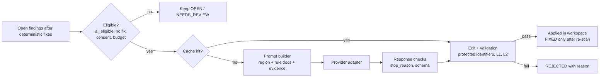

# AI Architecture and Token Optimization

Optional, provider-neutral AI assistance (OBJ-005). Delivered in phase P6:
[specs/007-ai-assistance](../../specs/007-ai-assistance/),
[handoff](phase-handoffs/PHASE_06_AI.md). Governing decisions: constitution Principle III,
[ADR-002](ARCHITECTURE_DECISIONS.md#adr-002--dependency-policy-stdlib-core-optional-adapters),
[ADR-012](ARCHITECTURE_DECISIONS.md#adr-012--ai-as-an-edit-producing-plugin). Data policy:
D-08 in [PLANNING_GAPS_AND_ASSUMPTIONS.md](PLANNING_GAPS_AND_ASSUMPTIONS.md).

## 1. Position in the system

AI is **never** on the critical path. With AI disabled the pipeline is identical minus this box.

## 2. Execution policy

1. Deterministic rules first. AI is considered only for findings whose rule declares
   `ai_eligible = true` and for which no deterministic `fix` applies (REQ-AI-002).
2. AI never invents compatibility rules or evidence. A finding without evidence-backed rule
   metadata is never escalated (FR-013 of the spec).
3. AI output is untrusted. It becomes an `Edit` and must pass the protected-identifier check
   plus L1/L2 validation like any edit (REQ-AI-003). `review_required` rules still cap the
   module status at `NEEDS_REVIEW` even if the AI edit is accepted.
4. Off by default. Enabling requires `--ai`, a configured provider, and the explicit consent
   flag `--ai-consent-send-code` (D-08 default).

## 3. Provider-neutral interfaces

Normative contract: [specs/007-ai-assistance/contracts/ai-provider.md](../../specs/007-ai-assistance/contracts/ai-provider.md)
(refines [CONTRACTS.md § AIProvider](architecture/CONTRACTS.md#aiprovider)).

| Concern | Design |
|---|---|
| Provider registration | Registry keyed by `name`, with a `contract_version` check. Built-ins: `fake`, `anthropic`, `openai-compatible` (also covers local servers exposing that API). Extra adapters are added via `--plugin`. |
| Model configuration | `providers.<name>.models[]` in the config file: `id`, `context_window`, `max_output`, optional `pricing`. **No model IDs, context sizes, or prices are hardcoded or asserted in code or docs**; they are user configuration. |
| Credentials | `credential_env` names an environment variable, or a secrets file outside scanned paths. CLI-argument keys are deprecated (D-10) and removed in P9. Always redacted. |
| Request construction | `AIRequest` with a versioned system template (no customer code), a user message containing `<code>` and `<evidence>` blocks, `response_schema`, `max_output_tokens`, `budget_ref`, `cache_key`, `region`. |
| Structured responses | JSON object `{replacement, notes, cannot_fix}` validated against the schema. Native JSON-schema modes are used when the adapter reports `json_schema` support; otherwise the response is parsed and validated locally. |
| Token usage | `usage{input, output, cached, estimated}` per attempt. Provider-reported counts are preferred; otherwise a documented heuristic is used and flagged `estimated`. |
| Cost accounting | Computed by OdooFlux from configured pricing × usage. `null` with the label "pricing not configured" when absent. |
| Errors | Adapters never raise for provider/HTTP errors. They return `stop_reason = error` with `error_kind ∈ {auth, rate_limit, transient, invalid_request, unknown}`. |
| Retries | Only for `rate_limit` and `transient`, with exponential backoff and a configurable bound (default 2). Each retry is counted in usage and budgets. |
| Caching | Prompt caching where the adapter supports it (`prompt_cache` capability). A verified-result cache is always available ([budget-and-cache.md](../../specs/007-ai-assistance/contracts/budget-and-cache.md)). |

## 4. Token optimisation

| Technique | Design | Correctness guard |
|---|---|---|
| Minimal relevant context | Send only the engine-selected region: one function, class body, or XML element. | Edits outside the region are rejected (`out_of_region`). |
| Function-level patches | The response is replacement text for the region, not a diff or a whole file (ADR-012). | Before-text check at apply time. |
| Dependency-aware context | Add only signatures (not bodies) of symbols referenced in the region and defined in the same module: imported names, `_inherit` target model name, fields used. Selected by the P4 parsers. | Signatures are read-only context; changes to them are rejected. |
| Evidence retrieval | Include the rule's documentation and the cited `EV-…` excerpts (claim text, URL, SHA, location) from the knowledge base. Never free web text. | Evidence IDs are part of the cache key. |
| Prompt caching | Stable system template and rule docs come first, then variable content, so providers with prefix caching can reuse them. | Cached and uncached prompts are semantically identical. |
| Verified-result caching | Key = region hash, rule, provider, model, prompt version, evidence IDs, step. | Cached results are re-validated before reuse. |
| Context deduplication | Identical regions (same hash + rule) across modules are requested once and reused. | Each reuse is validated in its own file. |
| Structured outputs | Short JSON response, no explanations beyond `notes` (capped). | Schema validation. |
| Batching | Several small regions for the **same rule** may share one request when the provider supports it and the combined size fits the request budget. The response is keyed per region. | Each region validated independently; a single failure does not affect the others. |
| Model selection by complexity | Config maps complexity tiers (region size, rule `ai_complexity` hint) to configured models. Escalation to a larger model happens only after a rejection by a smaller one, once. | Same validation regardless of model. |
| Budgets | Per request, file, module, and job; checked before sending against estimates, reconciled after. The job budget is mandatory when AI is enabled. | Over-budget means skipped and reported, never truncated silently. |
| Retry limits | Bounded transport retries. At most one re-request per region after a validation rejection. | Prevents cost loops. |
| Truncation detection | `stop_reason = max_tokens` → reject `truncated`. `max_output_tokens` is sized from the region length and capped by the budget. | No partial edit is ever applied. |
| Reporting | `ai_usage` in the report model: per provider/model totals, per module, budget events, cache hits, rejection reasons. | Totals equal the provider-reported sums (SC-004). |

## 5. Benchmarks

The P6 baseline is measured on a committed AI fixture corpus: one region per AI-eligible rule
type, with known-good expected outputs. Targets are **set from the recorded baseline** and
approved. No target is assumed in planning.

| Metric | Definition | How measured |
|---|---|---|
| Acceptance rate | accepted edits / requests | Fake provider (deterministic) and, opt-in, each configured real provider |
| Correctness rate | accepted edits that equal the expected output, or pass the fixture's semantic test / accepted edits | Golden expected outputs per fixture |
| Rejection rate by reason | count per reason code / requests | From usage records |
| Tokens per accepted edit | (input + output) / accepted | Provider-reported usage |
| Calls per finding | requests (incl. retries) / escalated findings | Usage records |
| Cache effectiveness | cache hits / eligible findings on the second run (target: all) | Re-run on unchanged corpus |
| Cost per accepted edit | configured pricing × usage / accepted | Only when pricing configured |
| Latency | median request duration | Usage records |

**Quality rule:** a configuration change that lowers tokens is accepted only if the correctness
rate does not drop on the benchmark corpus (token savings must never reduce correctness).

## 6. Security

| Threat | Defence |
|---|---|
| Customer code leaving the machine without consent | Off by default; the consent flag is separate from enable (D-08); the report records `consent: true` and the providers used |
| Data minimisation | Region-level context only; no file paths beyond module-relative ones; no secrets (redaction applied to prompts) |
| Prompt injection in customer code or comments | Code is placed in delimited data blocks; the system template states that block content is data; the AI cannot change the plan, rules, validators, or edit scope; output is validated (REQ-SEC-004, TST-007-009) |
| Malicious or wrong output | Protected-identifier check, L1/L2 validation, re-scan, `review_required` caps |
| Credential leakage | Env/secrets-file only; redaction in logs, reports, cache, and audit; canary-secret scan in P9 |
| Debug artefacts in customer modules | All AI artefacts under the state dir (REQ-SEC-003; legacy F-AI-6) |

## 7. Legacy mapping

| Legacy (odooflux.py) | Target |
|---|---|
| `ai_fix_all_modules` single bundle, whole files | Region-level requests with budgets |
| Hardcoded `CLAUDE_MODEL`, `CLAUDE_MAX_TOKENS` | Provider/model configuration |
| `--api-key` | Env or secrets file; deprecated per D-10 |
| `ai_response_debug.txt` in module | State-dir debug, redacted |
| All issues marked fixed | `FIXED` only by re-scan |
