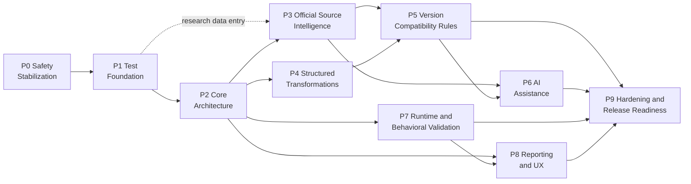

# Implementation Roadmap

Ordered, dependency-aware phases. Each phase is one Spec Kit feature (see
[README.md](README.md#phase--spec-kit-feature-mapping)) and has a self-contained handoff in
[phase-handoffs/](phase-handoffs/). The order was revised from the provisional brief per
[ADR-014](ARCHITECTURE_DECISIONS.md#adr-014--revised-phase-order).

## Dependency graph

The graph is acyclic. Topological order: P0, P1, P2, {P3, P4, P7}, {P5, P8}, P6, P9.

The critical path is P0 → P1 → P2 → P3/P4 → P5 → P6 → P9.

**Soft (data) dependencies.** These do not change the order. When the upstream phase is not done, the downstream component degrades as stated:
- P7 uses P3 knowledge data (core module lists, RNG file locations). Without it, the affected checks report `UNAVAILABLE`, which caps the status.
- P8 renders P6's AI usage section. Without it, the report shows "AI disabled".
- P6 uses P4 parsers for region selection, which is transitive through P5. P7 and P8 can run in parallel with
P3–P6 once P2 is done.

## Phase summary

| Phase | Objective | Depends on | Key deliverables | Requirements |
|---|---|---|---|---|
| P0 | Stop the legacy tool from damaging modules | — | Validation gate, no writes in analyze/dry-run, safe backups, removal of unsafe fixers, re-scan-based fix counts, version-suffix preservation | REQ-SAF-001…005, 006 (log), 010; REQ-TRF-005; REQ-MAN-001/002; REQ-REP-005 (basic); REQ-SEC-003; REQ-VAL-001 |
| P1 | Reliable test foundation | P0 | `unittest` harness, golden fixtures, characterisation suite, regression tests per finding, opt-in suites | REQ-TST-001…006 |
| P2 | Modular core | P1 | `src/odooflux` package, contracts, registries, version graph, planner, workspace/run log/rollback/resume, report model, cut-over | REQ-ARC-*, REQ-VER-001…006, REQ-SAF-006…009, REQ-TRF-001, REQ-VAL-002/006 (model), REQ-REP-001 (schema), REQ-DEP-002, REQ-SEC-001, REQ-PRF-001 (baseline) |
| P3 | Evidence knowledge base | P2 (code), P1 (data) | Evidence schema/validator, allow-list, registry data 12.0–19.0, step research records, matrix generator, refresh workflow | REQ-EVD-001…006, REQ-VER-001 (data) |
| P4 | Structured transformation infrastructure | P2 | Python/XML span locators, JS adapter + lexer fallback, edit conflict engine, idempotence harness, attrs→expression converter | REQ-TRF-001…004, REQ-PY-001/004, REQ-XML-001/002, REQ-JS-001/004 |
| P5 | Researched version rules | P3, P4 | Rule catalogue per step with evidence, tests, fixtures; manifest/deps/ACL/BIZ inventory | REQ-PY-002/003, REQ-XML-002/003/005, REQ-JS-002/003, REQ-MAN-003, REQ-DEP-001/003, REQ-ACL-001, REQ-BIZ-001, REQ-TST-002/003 (rules) |
| P6 | Optional AI | P3, P5 | Provider interface, fake + Anthropic + OpenAI-compatible + local adapters, budgets, caching, protected-identifier checks | REQ-AI-001…008, REQ-SEC-004 |
| P7 | Runtime/behavioural validation | P2 | Container runtime adapter, install/upgrade/tests, log analysis, RNG validation, status decision table | REQ-VAL-003…006, REQ-XML-004 (RNG), REQ-ACL-002, REQ-BIZ-002/003, REQ-SEC-002 |
| P8 | Reporting and UX | P2, P7 | Terminal, HTML, JSON schema, SARIF, diff, `--fail-on`, mockup parity | REQ-REP-001…006 |
| P9 | Hardening and release | P5, P6, P7, P8 | Performance budgets, incremental/parallel, audit log, secret scanning, failure injection, release checklist | REQ-PRF-*, REQ-SEC-005, REQ-AI-008 (final), REQ-TST-005 |

## Entry and exit criteria

### P0 — Safety Stabilization
- **Entry:** planning package approved; legacy `odooflux.py` at commit `c9914e6` or a later
  commit without behaviour changes.
- **Exit:**
  1. Every audit reproduction in Appendix A of
     [../reviews/ODOO_MODULE_UPGRADER_AUDIT.md](../reviews/ODOO_MODULE_UPGRADER_AUDIT.md) has a
     passing regression test.
  2. The analyze/dry-run hash test passes.
  3. Injected invalid output is never written.
  4. Backups land outside the addons path and are verified.
  5. Fix counts come from a re-scan.
- **Deliverables:** patched legacy script, `tests/regression/` P0 suite, change record.

### P1 — Test Foundation
- **Entry:** P0 exit met.
- **Exit:**
  1. `python -m unittest discover -s tests` passes offline.
  2. Golden fixtures exist for source versions 12.0–18.0 with expected legacy outputs.
  3. The characterisation suite pins current CLI behaviour.
  4. Opt-in suites are skipped by default.
- **Deliverables:** `tests/unit`, `tests/integration`, `tests/regression`, `tests/golden_fixtures`,
  test conventions doc.

### P2 — Core Architecture
- **Entry:** P1 exit met; D-01 (constitution 2.0.0) and D-09 (packaging) approved.
- **Exit:**
  1. Contracts implemented and contract tests pass.
  2. Registries accept sample plugins without core edits.
  3. The version graph plans every pair in the registry.
  4. Workspace, run log, rollback, and resume pass failure-injection tests.
  5. Report model v1 is published.
  6. Cut-over is done and the characterisation suite passes (or each difference is documented).
  7. The determinism test passes.
  8. The baseline benchmark is recorded.
- **Deliverables:** `src/odooflux/{cli,core,discovery,versions,dependencies,reporting/model,utils}`.

### P3 — Official Source Intelligence
- **Entry:** P2 exit met (code). Data entry may begin after P1.
- **Exit:**
  1. Evidence schema validator and domain allow-list are enforced.
  2. Registry data for 12.0–19.0 exists with research status.
  3. Every seed record from the planning register is migrated.
  4. The matrix is generated from data.
  5. The refresh workflow is demonstrated on two SHAs.
  6. Research gaps are recorded as data.
- **Deliverables:** `src/odooflux/knowledge/**`, research procedure doc, generated matrix.

### P4 — Structured Transformations
- **Entry:** P2 exit met; D-02 (JS adapter) decided.
- **Exit:**
  1. Span locators are exact on the fixture corpus.
  2. The edit engine handles conflicts, before-text checks, and idempotence.
  3. The attrs/states → expression converter passes its corpus.
  4. Byte preservation outside spans is proven on golden fixtures.
  5. The JS adapter works, and the fallback is detect-only.
- **Deliverables:** `src/odooflux/{parsers,transformers}`, converter, corpus tests.

### P5 — Version Compatibility Rules
- **Entry:** P3 and P4 exit met; D-04 (lowest supported source version) and D-05 (Enterprise
  access) decided.
- **Exit:**
  1. Every rule has evidence, maturity, and positive/negative/idempotence tests.
  2. Every step in scope has a research record.
  3. The matrix shows `RULES_TESTED` only where true.
  4. Golden migrations pass per source version.
  5. Legacy rules are mapped (kept, corrected, or retired) with rationale.
- **Deliverables:** `src/odooflux/rules/**`, `knowledge/compatibility/*.json`, fixtures.

### P6 — AI Assistance
- **Entry:** P3 and P5 exit met; D-08 (data policy and default provider) decided.
- **Exit:**
  1. Provider contract tests pass for the fake provider and each shipped adapter.
  2. Budgets, truncation, caching, and protected-identifier rejection are tested.
  3. Benchmarks are recorded (quality and tokens).
  4. AI is off by default.
- **Deliverables:** `src/odooflux/ai/**`, benchmark report.

### P7 — Runtime and Behavioral Validation
- **Entry:** P2 exit met; D-03 (containers) decided.
- **Exit:**
  1. Install and upgrade on the target version run in isolation with limits.
  2. Log analysis classifies errors.
  3. Behavioural comparison of source and target test runs works.
  4. The status decision table is fully tested.
  5. RNG validation runs when available.
- **Deliverables:** `src/odooflux/validation/{runtime,behavioral,static}`, `tests/runtime/`.

### P8 — Reporting and UX
- **Entry:** P2 exit met (schema); P7 status model merged.
- **Exit:**
  1. All renderers consume the report model.
  2. Terminal snapshots (colour and plain) pass.
  3. The HTML report works offline.
  4. SARIF validates.
  5. The diff applies.
  6. The `--fail-on` table is tested.
  7. Mockup parity is reviewed.
- **Deliverables:** `src/odooflux/reporting/{terminal,html,exporters}`.

### P9 — Hardening and Release Readiness
- **Entry:** P5, P6, P7, and P8 exit met.
- **Exit:**
  1. Performance budgets are met at 300 modules.
  2. Incremental and parallel runs are deterministic.
  3. The audit log is complete.
  4. Secret scanning is clean.
  5. The failure-injection suite passes.
  6. Every requirement in the RTM has passing verification.
  7. The release checklist is signed off.
- **Deliverables:** benchmarks, hardening tests, release notes, support statement per version.

## Version support milestones

A version path is advertised as supported only when all of its steps are `RULES_TESTED` and the
target is `RUNTIME_VALIDATED` (Principle VI). The planned order of verification follows customer
value and evidence availability: 17→18, 18→19, 16→17, 15→16, 14→15, then 13→14 and 12→13, which
have the weakest documentation (G-R-01).
