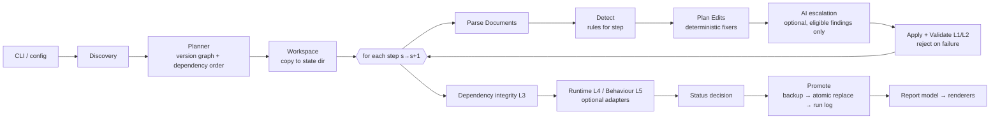
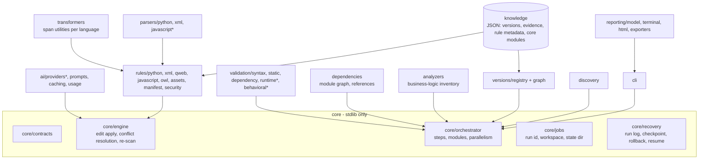

# Target Architecture

Design for OdooFlux as a multi-version, evidence-driven Odoo module migration tool. Decisions
are recorded in [ARCHITECTURE_DECISIONS.md](ARCHITECTURE_DECISIONS.md). Interfaces are defined
in [architecture/CONTRACTS.md](architecture/CONTRACTS.md). The current system is described in
[CURRENT_ARCHITECTURE_AUDIT.md](CURRENT_ARCHITECTURE_AUDIT.md).

## 1. Design principles

1. **Read-only by default**: analysis never touches inputs (REQ-SAF-001).
2. **Parse to locate, splice to edit**: targeted, attributable edits (ADR-003).
3. **Evidence before automation**: no fixer without official evidence (ADR-008, REQ-EVD-003).
4. **Validate before promote, re-scan before claiming**: REQ-SAF-002, REQ-TRF-005.
5. **Stdlib core, optional adapters**: ADR-002.
6. **Data-driven versions**: no hardcoded maximum version (REQ-ARC-003).

## 2. Pipeline

Analyze and dry-run stop before **Promote**, so the inputs remain untouched by construction.

## 3. Component view

`*` marks optional adapters that need third-party software (ADR-002, ADR-006, ADR-011).

## 4. Key flows

### 4.1 Requested path vs internal steps

A request `14.0 → 19.0` becomes the steps `14-15, 15-16, 16-17, 17-18, 18-19` (ADR-007). Each
step runs its rules on the output of the previous step, in memory, and validates syntax and
static compatibility after each step. Runtime validation runs once, at the target, unless
`--validate-intermediate` is given. If any step is not researched, the plan is `BLOCKED`, or
`NEEDS_REVIEW` with `--allow-unverified` (REQ-VER-003).

### 4.2 Edit lifecycle

`PLANNED → (conflict check) → (before-text check) → APPLIED in workspace → validators →
kept | REJECTED`. Kept edits are promoted at the end. Rejected edits keep their findings `OPEN`
with a reason. Fix status is assigned only by a re-scan diff.

### 4.3 AI escalation

Only findings with `ai_eligible=true` and no deterministic fix, within budget. The engine sends a
bounded region with the evidence excerpt, receives replacement text, wraps it in an `Edit`, and
runs the same validators plus a protected-identifier check. See
[AI_ARCHITECTURE_AND_TOKEN_OPTIMIZATION.md](AI_ARCHITECTURE_AND_TOKEN_OPTIMIZATION.md).

### 4.4 Status decision

Result statuses and their exact conditions are defined in
[VALIDATION_AND_TEST_STRATEGY.md](VALIDATION_AND_TEST_STRATEGY.md#result-statuses). That table
is normative and is evaluated top to bottom; this is an informative summary in the same order:

| Status | Condition (first match wins) |
|---|---|
| `BLOCKED` | Plan refused, backup/workspace/promotion failure, tool error, or a layer required via `--require` is unavailable or skipped |
| `FAILED` | Any layer that ran failed, or an open CRITICAL finding remains after fixes and re-scan |
| `NEEDS_REVIEW` | Open review-required finding or WARNING, `--allow-unverified` used, or an adapter needed for a file kind present in the module is unavailable |
| `VERIFIED_SUCCESS` | L1–L4 pass and L5 passes with full coverage |
| `INSTALL_VERIFIED` | L1–L4 pass; L5 skipped, unavailable, or partial |
| `STATIC_VALIDATED` | L1–L3 pass; L4 skipped or unavailable |

## 5. Extension points

| Extension | How (no core edits) | Procedure |
|---|---|---|
| New Odoo version | Add registry entry, step evidence, step rules, fixtures | [MIGRATION_RULE_ENGINE.md §Adding a version](MIGRATION_RULE_ENGINE.md#adding-a-new-odoo-version) |
| New rule | Rule metadata JSON + detector/fixer + tests | [MIGRATION_RULE_ENGINE.md](MIGRATION_RULE_ENGINE.md) |
| New AI provider | Implement `AIProvider` adapter, register | [AI_ARCHITECTURE_AND_TOKEN_OPTIMIZATION.md](AI_ARCHITECTURE_AND_TOKEN_OPTIMIZATION.md) |
| New validator | Implement `Validator`, declare layer and adapters | [VALIDATION_AND_TEST_STRATEGY.md](VALIDATION_AND_TEST_STRATEGY.md) |
| New parser | Implement `ParserAdapter` | [architecture/CONTRACTS.md](architecture/CONTRACTS.md#parseradapter) |
| New report format | Implement `Renderer` | [REPORTING_AND_UX.md](REPORTING_AND_UX.md) |
| New runtime | Implement `RuntimeEnvironment` | [VALIDATION_AND_TEST_STRATEGY.md](VALIDATION_AND_TEST_STRATEGY.md) |

## 6. Scale and performance

- Modules are processed in dependency order; independent modules run in a process pool with
  deterministic result ordering (REQ-PRF-003).
- Documents are parsed once per step and cached by content hash; incremental mode skips
  unchanged files (REQ-PRF-002).
- Runtime validation is the dominant cost. It is batched per target version: one container
  set, with modules installed in dependency order.

## 7. Security boundaries

Customer code is data to the core. It is never imported or executed by the tool process.
Execution happens only inside the runtime adapter's container (REQ-SEC-001). AI requests carry
the minimum region needed and are logged as metadata only. Details are in
[SECURITY_AND_SAFETY.md](SECURITY_AND_SAFETY.md).
