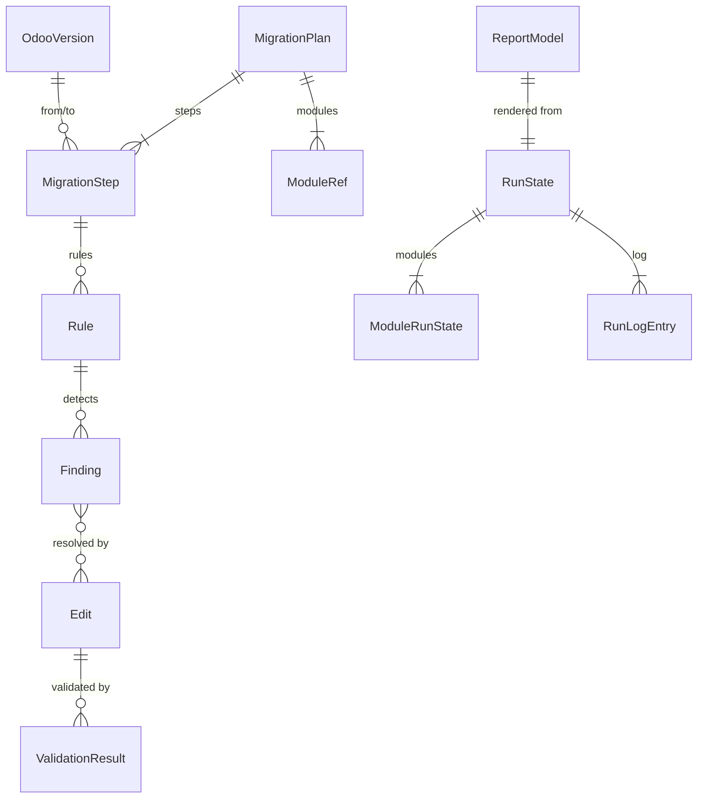

# Data Model: Core Architecture (P2)

The normative field lists are in
[docs/planning/architecture/CONTRACTS.md](../../docs/planning/architecture/CONTRACTS.md). This file
adds P2 decisions, relationships, validation rules, and state transitions. It does not redefine
fields.

## Entities and relationships



## P2 additions (not in CONTRACTS.md)

### ModuleRef

`name`, `path` (absolute, resolved), `manifest_path`, `declared_version` (from manifest),
`depends` (list[str]), `order_index` (topological position).

### RunState (`runs/<run-id>/state.json`)

| Field | Rule |
|---|---|
| `schema` | `"odooflux.runstate/1"` |
| `run_id`, `mode` (`analyze`/`dry_run`/`fix`), `plan_digest` | Immutable after creation |
| `modules[]` | `{name, status, source_digest, promoted_files[], checkpoint_at}` |
| `status` | `RUNNING`, `INTERRUPTED`, `COMPLETED`, `ROLLED_BACK` |

### ModuleRunState.status transitions

```
PENDING → WORKING → VALIDATED → PROMOTING → PROMOTED
                 ↘ BLOCKED/FAILED          ↘ FAILED (auto-restore)
PROMOTED → ROLLED_BACK (rollback)
```

Resume rules: `PROMOTED` modules are skipped; `PROMOTING` modules are restored from backup and
redone; `WORKING`/`VALIDATED` modules restart from a fresh workspace copy. Resume is refused if
`source_digest` differs from the current source.

### RunLogEntry v1

The P0 fields ([001 data-model](../001-safety-stabilization/data-model.md)) plus `edit_ids[]`,
`step`, and `event` values `file_created`, `file_restored`, `rollback_conflict`.

### Result status decision (pure function)

Input: the layer outcomes L1–L5 (`PASS`/`FAIL`/`UNAVAILABLE`/`SKIPPED`), open findings by severity,
review-required count, plan flags (unverified steps), and the blocked reason. Output: one of six
statuses plus `status_reasons[]`. The decision table is owned by
[VALIDATION_AND_TEST_STRATEGY.md](../../docs/planning/VALIDATION_AND_TEST_STRATEGY.md#result-statuses).
P2 implements it and tests every row. P7 supplies the real L4/L5 outcomes.

## Validation rules

- `OdooVersion.id` is unique, and versions are totally ordered by numeric major/minor.
- A step exists only between consecutive registry versions.
- `Edit.before` must equal the current text slice at apply time, otherwise `REJECTED`.
- `Finding.status = FIXED` only by the re-scan diff.
- Registry IDs are unique per registry; a duplicate registration is an error.
